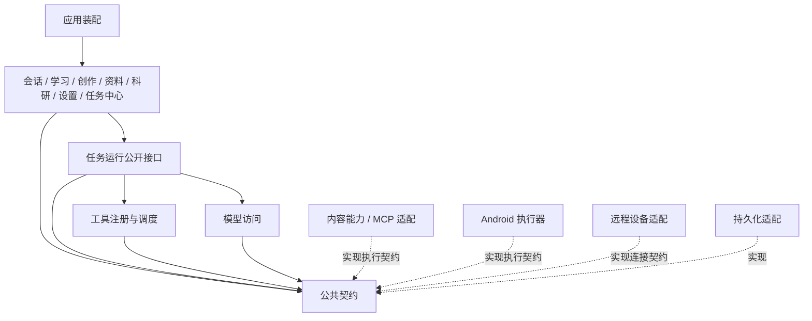

# 模块依赖与协作规则

> 本文保留现有职责定位与增量方案参考。整体重构的当前目标以 [V2 架构](V2-ARCHITECTURE.md) 和 [V2 实施计划](../plans/AGENT-V2-REBUILD.md) 为准，不同时执行两份目录迁移方案。

本文件是目标边界，尚未声明现有代码已完全满足。现有跨模块耦合由下文的过渡清单承接；执行迁移时按工作包消除。

## 1. 总体依赖方向

实线表示使用公开接口，虚线表示实现契约。运行时拿到的是注入后的接口，不导入平台适配器的具体实现。模块登记表中的 `depends_on` 同样只允许访问目标模块的公开入口，并不授权访问其内部文件。

## 2. 依赖规则

| 规则 | 允许 | 禁止 |
| --- | --- | --- |
| R1 公共契约独立 | 使用基础类型与序列化约定 | 引用 Widget、Riverpod、数据库连接、HTTP 客户端或具体平台 |
| R2 产品通过 API 协作 | 学习向任务接口提交课程生成输入；会话消费任务事件 | 学习直接修改聊天控制器内部状态；资料库直接写课程表 |
| R3 运行模块独立 | 使用模型、工具、任务存储和事件输出接口 | 访问当前页面、当前选中会话或 UI 全局状态来决定正在执行的任务 |
| R4 模型适配保持通用 | 输入统一消息/工具描述，输出增量/用量/失败 | 读取故事角色、课程、项目数据库，或按界面路由选择协议 |
| R5 工具实现可替换 | 搜索、文档、Android、电脑各自实现工具契约 | 在注册器内逐渐塞入所有工具的网络、文件和平台细节 |
| R6 存储机制与业务分工 | 共享 SQLite 连接，业务模块拥有自己的仓库与实体规则 | 把所有业务写入集中到一个万能 DataService，或多个模块随意修改同一实体 |
| R7 配置有明确所有者 | 设置页面编辑模块公开的配置片段；运行时使用本轮快照 | 在运行中跟随全局选中模型/主机变化，把同一任务送到另一设备 |
| R8 连接不能决定业务终态 | remote_link 报告断连、身份变化、事件缺口 | 把连接断开直接写为任务失败，或自动创建替代任务 |
| R9 兼容层单向 | 旧入口通过适配调用新公开接口；保留旧部署回退 | 新任务核心反向依赖旧 Gateway/OIDC/REST 文档配置 |
| R10 应用装配集中 | App 组装产品、能力与基础设施 | 领域模块反向导入 `core/providers.dart` 等装配入口 |

## 3. 数据所有权

| 数据 | 唯一业务所有者 | 其他模块如何使用 |
| --- | --- | --- |
| 会话、消息、分支、草稿 | conversation | 读取上下文快照；任务完成后通过会话接口更新展示 |
| 项目与资料关联 | workspace/projects | 取得带版本的项目说明、文件清单与作用域 |
| 素材字节、元数据、生图版本 | workspace/library | 使用资产引用与受控读取；生产能力提交产物后由资料库登记 |
| 长期记忆及候选审核 | workspace/memory | 召回快照、提交候选；生成器不得自行把候选写为已确认记忆 |
| 课程、题目、作答、错题、复习与每日档案 | learning | 输入为学习快照，产出由 learning 验证后提交 |
| 角色、世界信息与剧情状态 | creation | 提供上下文贡献；通用模型/任务模块不导入领域实体 |
| 任务、步骤、动作尝试、事件、产物清单 | 执行设备上的运行时 | UI 和其他设备只保留投影或引用，通过任务接口操作 |
| 设备身份、配对状态、连接凭据引用 | remote_link | 公开能力与连接状态，不向模型或工具参数暴露完整凭据 |
| 模型/能力连接配置与密钥引用 | 对应能力模块 | settings 提供编辑入口；秘密由安全存储接口解析 |
| 数据库连接、迁移和备份提交标记 | storage | 提供机制与事务，不能自行决定学习/创作业务规则 |

当前每日学习档案仍在 SharedPreferences，记忆仍在 Markdown；本轮模块划分不改变这两个存储事实。未来迁到数据库时，作为独立数据迁移工作包验收。

## 4. 设置与备份的聚合方式

设置和备份确实需要跨模块，但通过显式的贡献接口聚合：

- 模块公开可编辑配置、校验规则、秘密引用和配置版本；设置工作区负责展示与协调保存。
- 业务模块公开备份内容、校验和副本导入能力；备份协调器管理整体恢复日志及提交顺序。
- 未完成任务元数据可以备份，但导入为新副本后必须处于不自动执行的状态；不把正在运行的电脑进程伪装为可在手机继续执行。
- 新任务数据落库时，必须设计独立 schema 升级与旧版本恢复用例；当前 v17 和 ECBACKUP v1 是兼容基线，不提前占用未来版本号。

## 5. 三条模块协作路径

**普通对话 / 学习 / 创作**：产品模块准备意图和上下文快照 → 任务接口接受输入 → 运行模块调用模型和工具 → 发出事件/产物 → 产品模块提交自己的业务结果。

**手机跨 App 任务**：任务中心指定本机目标 → 运行模块从能力目录选择 Android 工具 → Kotlin 执行观察/动作 → 返回新观察与动作结果 → 运行模块核验并推进。权限失效、目标窗口改变或结果不确定时，执行器必须返回具体状态。

**电脑任务**：手机选择已配对设备 → remote_link 提交任务 → 电脑运行时持久化后确认接收 → 电脑独立执行 → 手机读取有序事件和产物。CLI 与手机共用同一个电脑任务 API。

## 6. 过渡期的明确例外

| 现有边界 | 暂时保留的原因 | 消除例外的里程碑 |
| --- | --- | --- |
| `state/chat*` 仍同时处理会话与执行 | 保持现有工具、停止、持久化行为可回归 | P1：同一运行模块同时服务聊天入口与独立任务入口 |
| `data/models.dart` 混合消息、任务、故事相关数据 | 被大量现有模块使用，不能按文件一次切断 | P1/P5：按所有者迁出，兼容导出只转发类型，不产生副本 |
| `settings_state.dart` 聚合模型、媒体、Gateway、界面等配置 | 原有设置保存与导入导出需要连续兼容 | P1/P5：能力配置有所属模块，settings 只协调 |
| `core/providers.dart` 负责大部分装配 | 当前统一启动与测试覆盖依赖该入口 | P1：装配迁入 app，模块测试可自行注入依赖 |
| `LongTaskRunner` 保存旧 Gateway 文档任务 | 有明确的旧任务恢复语义与测试 | P4：新旧任务类型显式区分，旧任务继续使用兼容适配 |
| Dart 手机运行时与 Rust 电脑运行时并存 | 电脑需脱离手机独立调用模型与执行工具 | P3/P4：共享协议契约与一致性用例；P6 再评估共享 Rust 库 |

这些例外有退出条件，不通过创建空目录或转发层来宣称已经解耦。

## 7. 迁移后的约束方式

在迁移实际触及的模块时，利用现有仓库检查补上必要的依赖约束；先通过公开入口和代码审查限制跨模块内部访问，重复出现违规后再自动检查对应规则。登记表是设计参考，不作为启动时加载的动态注册系统，也不要求首期开发完整的架构检查框架。

模块验收同时检查业务场景：任务更换入口、断连与取消、资料作用域、数据恢复。依赖图变得整齐不能替代这些场景通过。

## 8. 实现复杂度的限制

- 对来自模型、网络、文件和设备的外部数据，在所属边界完成解析与校验；内部使用明确类型，不在每层重复同一项检查。动作执行前复查权限或目标窗口属于检查会变化的条件，需要保留。
- 能处理的错误在所属模块处理，其余保留原因并向调用方报告；不把失败改成空数据、占位结果或成功，不用宽泛 catch 掩盖内部错误。
- 重试由一处拥有次数、条件与取消状态，沿用现有预算；不叠加多层重试。结果不确定的写动作先核验，不自动重放。
- 先使用直接调用、现有仓库和普通事件流。只有真实的多实现、跨进程或复用需求出现时，才新增接口和序列化层。
- 任务状态表与有序日志即可支持首版查询和重连；不扩展成整个产品的事件溯源、全局事件总线或通用工作流平台。
- 迁移适配只服务于明确的切换过程，切换验收后删除；已部署旧 Gateway 的兼容需求单独维护，不为新功能预造另一套回退实现。
