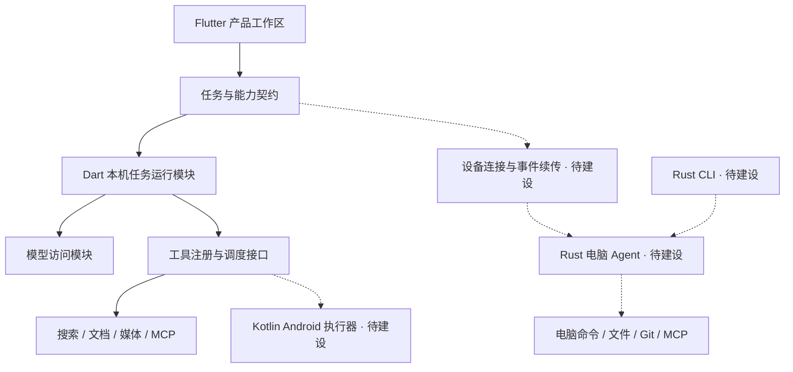

# 增量演进基线（备选）

> 当前整体重构规划见 [V2 架构](V2-ARCHITECTURE.md) 与 [V2 实施计划](../plans/AGENT-V2-REBUILD.md)。本文保存此前的增量方案，作为参考与备选。

更新日期：2026-10-22。适用于当前 Expert Chat 工作区，包含未提交的功能与修复；不是已发布版本的功能承诺。

本轮完成模块划分、依赖边界、目标目录和迁移计划。目标目录尚未搬迁；Android 跨 App 执行器、设备配对、Rust 电脑 Agent 与 CLI 均为待建设能力。

## 本项目的产品目标

以 Android 手机为主要入口，提供聊天、学习、创作与资料工作区；手机能在授权范围内执行跨 App 任务，也能把任务交给电脑独立执行，随后查看进度和结果。电脑同时支持 CLI。

当前项目采用增量演进：Flutter 承载现有产品界面，Dart 延续已有模型与任务能力，Kotlin 实现 Android 系统操作，Rust 新建电脑执行服务和 CLI，Python 文档 MCP 作为独立内容服务复用。是否让手机也调用 Rust 核心，在两端任务契约稳定后另作决策。

实施规模：登记表的 23 项是职责定位，不要求创建 23 个独立包或服务。首个工作包复用现有执行组件，只抽出任务调用与事件输出边界；Rust 电脑端先用一个 crate。跨语言 Schema、通用插件机制及更多包拆分，在出现实际使用方时再引入。

## 文档入口

| 文档 | 回答的问题 |
| --- | --- |
| [模块地图](MODULE-MAP.md) | 当前有什么模块，哪些需要拆清、合并归口或新增？ |
| [依赖与协作规则](DEPENDENCY-RULES.md) | 谁能依赖谁，谁拥有任务、数据和配置？ |
| [目标目录与迁移映射](TARGET-STRUCTURE.md) | 模块以后放在哪里，现有目录如何逐批迁移？ |
| [任务与设备协作](TASK-AND-DEVICE-CONTRACTS.md) | 手机、电脑、模型和工具如何协作及恢复？ |
| [分阶段实施计划](../plans/AGENT-EVOLUTION.md) | 先做什么，交付什么，如何验收和回退？ |
| [模块登记表](module-catalog.json) | 模块 ID、状态、现有证据路径、目标路径与允许依赖的机器可读清单 |
| [当前项目 HTML 框图](../project-map.html) | 已有实现的结构与功能浏览；不包含未来能力的完成承诺 |

## 当前事实与缺口

源码基线：`pubspec.yaml` 为 `3.6.1+4109`，SQLite schema 为 17，完整备份容器为 ECBACKUP v1。最近客户端检查为 1462 项测试通过，检查记录位于工作区 `output/protocol-auto/verified-client.log`。这些结果不代表 Android 设备自动化或未来 Rust 服务已通过验收。

| 范围 | 当前事实 | 下一阶段需要的模块边界 |
| --- | --- | --- |
| 产品界面 | Flutter 的会话、学习、创作、资料、科研与设置已存在 | 产品工作区负责用户意图、内容与展示 |
| 模型接入 | 四协议适配、自动尝试、流式输出、用量与错误处理已存在 | 独立模型访问能力，禁止感知学习/故事实体与页面 |
| 任务执行 | 已有预算、流生命周期、工具循环、步骤恢复；部分能力已从控制器抽出 | 一次任务由独立运行模块持有，聊天只是任务入口与展示入口之一 |
| 手机操作 | 原生层已有生成前台服务、分享接收、目录上传等 | 新建 Android 观察与动作执行器，不能将现有前台服务视作手机 Agent |
| 科研终端 | SSH/SFTP/tmux、命令提议与用户确认已存在 | 保持为交互工作区；它与电脑自主任务服务有不同的生命周期 |
| 文档处理 | 单用户文档 MCP 与受限 worker 已存在 | 继续作为文档能力服务，不承担通用设备调度 |
| 电脑自主任务 | 当前没有 Rust Agent 服务或独立 CLI | 新建电脑运行时，持有任务、进程、工作目录、结果与恢复状态 |
| 远程协作 | 已有 SSH 与 MCP 连接，但没有通用设备任务配对/重连体系 | 新建设备连接模块，定义身份、能力协商和事件续传 |

本次扫描得到 326 个非生成 Dart 文件、10 个 `features` 子目录、23 个 `domain` 子目录。`data/models.dart` 被 66 条内部 import/export 引用，覆盖 17 个扫描分区，且自身关联故事领域。这说明共享数据边界需要调整；数字仅是结构快照，不是质量评分。扫描原始记录位于本地 `output/module-plan/current-survey.json`。

## 优化的核心决定

1. **按业务模块归口。** 学习、创作、资料与科研各自拥有应用逻辑、状态和数据访问，目录不再以所有页面、所有控制器、所有仓库为主要导航。
2. **任务执行成为独立能力。** 运行模块负责任务状态和工具轮次；产品模块提供本次任务的内容快照并消费事件。
3. **工具能力与设备能力分开。** 搜索、文档、媒体、语音是一组内容能力；Android 操作与电脑命令执行有各自的平台约束和授权边界。
4. **设备连接与任务运行分开。** 连接断开不等于任务失败；重连查询已有任务，不能隐式重建任务。
5. **存储共享实现，数据分属业务。** 可以继续使用同一个 SQLite 数据库，但只有所属模块可以决定对应实体的业务变更。
6. **新电脑服务与旧部署分开。** 保留 Gateway/AuthService 的兼容入口；新 Agent 不继承其全部账户、REST 文档与任务假设。

## 目标运行关系

以下为目标关系，虚线部分目前尚未实现。

## 如何使用这份基线

新需求先确定所属模块、数据所有者和执行设备，再决定页面与技术实现。跨模块变更必须说明双方契约；目录搬迁与新增行为分开验收。当前物理目录仍是 `lib/core`、`data`、`domain`、`features`、`state`，应通过模块地图定位现有代码，不能把目标目录当成已存在的实现。

本轮文档验证：23 个模块登记、84 个现有路径、80 条目标公开依赖、91 个本地文档链接已校验；目标依赖图无环，仓库策略检查通过。记录位于本地 `output/module-plan/verification.json`。本轮没有业务代码变更，未重复运行客户端全量测试。
