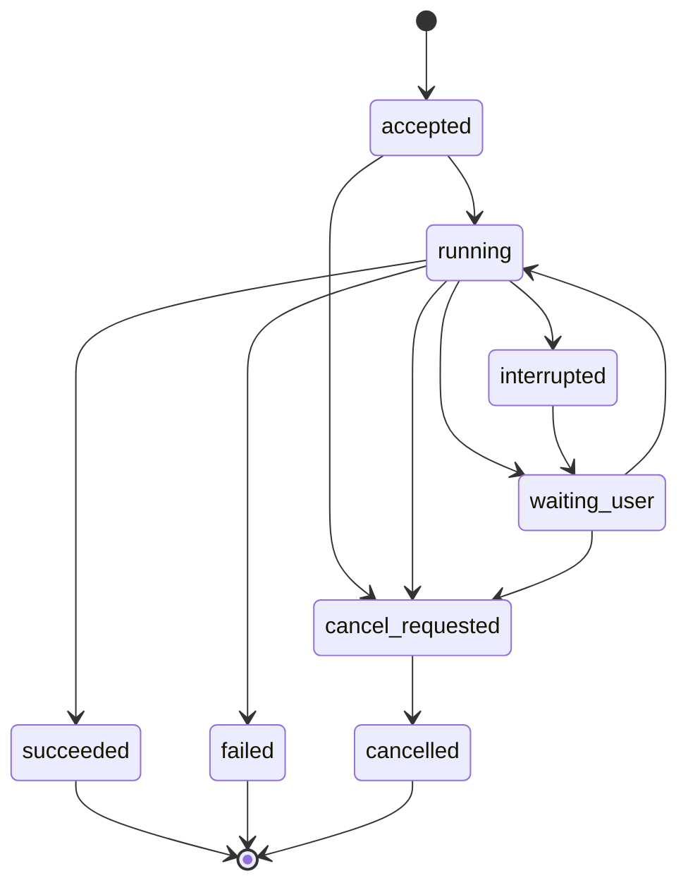

# 任务与设备协作契约

> 本文的任务身份、执行目标、取消、事件和恢复语义继续适用于 [V2 架构](V2-ARCHITECTURE.md)。下文 P 阶段编号属于原增量计划，V2 的实施时序以 [新计划](../plans/AGENT-V2-REBUILD.md) 为准。

本文件规定模块间需要共同理解的语义。这里的概念尚未全部实现：P1 仅落地本机调用需要的类型，P3/P4 再版本化真实的跨进程消息。概念表不等于需要逐项创建接口、基类、适配器或代码生成系统。

## 1. 四个不能混为一谈的对象

| 对象 | 含义 | 身份与生命周期 |
| --- | --- | --- |
| 会话 | 用户与模型/任务的交互历史 | 会话 ID；切换页面不决定任务终止 |
| 任务 | 在明确执行设备上完成一个目标 | 稳定任务 ID、尝试 ID、执行设备 ID；由执行端持有 |
| 工具动作 | 一次观察、查询、修改或命令执行 | 步骤/动作 ID；记录是否已提交、是否确定执行及结果 |
| 连接 | 客户端与执行设备之间的通信会话 | 可重连；连接更换不生成新任务 |

一个会话可以关联多个任务，一个任务可以在聊天和任务中心同时展示。任务结果通过引用进入消息，不能让消息 ID 同时承担所有跨设备幂等职责。

## 2. 公共交互内容

| 契约 | 必需语义 | 所属边界 |
| --- | --- | --- |
| TaskSpec | 用户目标、输入/资产引用、执行目标、预算、允许能力、模型配置引用、上下文版本 | 产品模块 → 运行时 |
| TaskHandle | 任务身份、执行设备、接收状态、可操作能力 | 运行时 → 产品/CLI |
| TaskEvent | 任务/尝试/步骤身份、同一任务内严格递增且跨尝试不回退的事件序号、类型、时间、脱敏内容 | 运行时 → 订阅方 |
| ToolDescriptor | 输入/输出约定、所需能力、读写性质、取消/重试约束 | 能力模块 → 工具目录 |
| ToolRequest | 动作身份、目标设备/工作区、参数、必要的确认凭据、前置观察版本 | 运行时 → 执行器 |
| ToolResult | 成功/失败/取消/结果不确定、观察与产物、错误类别、核验依据 | 执行器 → 运行时 |
| ArtifactRef | 所属设备、资产身份、名称、类型、大小、摘要和读取权限 | 内容/设备执行器 → 资料模块与 UI |
| DeviceDescriptor | 稳定设备身份、运行时/协议版本、在线状态和实际可用能力 | 设备连接 → 任务入口 |

这些契约传递稳定值和引用，不传 Widget、Riverpod Ref、数据库句柄、进程对象或完整设置状态。模型密钥、SSH 私钥不进入工具参数和任务事件。

## 3. 任务状态与连接状态分别管理

- `accepted` 只能在执行端持久化接收结果后确认；用户看到已接收应有可查询的任务身份。
- `waiting_user` 包括需要确认、补充输入、权限恢复或结果不确定的场景；具体原因保存在事件中。
- `cancel_requested` 与 `cancelled` 分开：收到停止请求不等于操作系统进程树已停止。
- UI 关闭或网络断开不直接改变运行中的电脑任务状态；客户端显示“连接断开，任务状态待同步”。
- 执行端重启后的未完成任务先标记 `interrupted` 并核对外部状态，不能默认从最后一条日志自动重放写操作。
- 新尝试产生新尝试 ID 并引用原任务，失败结果和已有证据保留。

手机进程被系统终止后不能假定本地动作继续运行；前台服务也不构成永久运行保证。恢复页面先读取状态，再由任务规则决定下一步。

## 4. 设备目标必须明确

每个任务的执行目标在接收时固定。切换当前选中电脑、模型配置或页面，不能把已有任务的下一条动作发给新目标。

跨设备流程通过有明确父子关系的子任务交接：例如手机取得用户选定材料后，在电脑上启动“处理材料”子任务，并显式传递必要的资产。不能把整个手机文件目录或所有凭据作为隐式上下文同步到电脑。

能力目录按设备发布：`观察手机界面`、`输入文本`、`运行命令`、`修改工作区文件` 是不同能力。模型只能选择当前任务实际获准且目标设备声明支持的工具。

## 5. 手机执行路径

1. 产品入口取得用户目标及必要授权，提交本机任务。
2. 运行模块要求 Kotlin 执行器观察当前 App/窗口，生成观察引用。
3. 模型提出动作，执行器核对目标、权限、观察是否过期和动作前置条件。
4. Kotlin 执行动作后重新观察，返回明确结果；运行模块基于新观察推进。
5. 权限撤销、窗口不符或动作效果不明确时停止自动推进，记录原因。页面上的文本属于观察数据，不能自行扩大任务权限。

可用技术接口包括 Android 控件树、控件动作、手势和用户授权的截图来源；它们不保证所有 App 的所有内容都可读取或操作。[Android AccessibilityService](https://developer.android.com/guide/topics/ui/accessibility/service?hl=en)、[MediaProjection](https://developer.android.com/media/grow/media-projection)。

## 6. 电脑执行路径

电脑运行时是独立任务所有者；手机仅持有投影。CLI 和手机通过相同任务语义操作它。

电脑自主任务必须在电脑侧具备可用模型连接、工具注册与调度、持久任务状态、进程管理和核验逻辑。仅暴露 SSH 命令、仅提供 MCP tools/call 或仅开启一个 WebSocket，都不足以形成能脱离手机继续工作的 Agent。

首个实现以 Windows 为验收平台：PowerShell/命令进程、工作目录、标准输出/错误、交互式终端需求、超时和进程树终止分别验收。后续 Linux/macOS 由对应执行器和平台测试覆盖，不把 Rust 跨平台编译当成行为已一致。

## 7. 配对、事件续传和幂等

- 手机通过用户确认的配对建立设备身份和受限访问凭据；后续校验的是该身份，不仅是一个可变 IP 地址。
- 每次任务提交携带幂等标识；执行端必须持久化“提交标识 → 任务”的对应关系。提交超时后先查询，不能直接创建新的任务。
- 事件可以至少一次送达，客户端按设备、任务和序号去重投影；缺口通过快照与事件重放补齐。
- 不承诺任意命令恰好执行一次。写操作在“已提交但结果未知”时需要核验或人工决策，不能靠网络重试掩盖不确定性。
- 文件与产物单独传输并验证大小/摘要；断线重试不可覆盖未授权的本地路径。
- 手机取消请求需由电脑确认。电脑未确认时 UI 保留“停止请求待确认”，避免假报已停止。

## 8. 数据与凭据驻留

| 执行方式 | 模型配置与凭据 | 任务状态 | 文件 |
| --- | --- | --- | --- |
| 手机本机任务 | 手机安全存储中的配置引用 | 手机任务存储 | 手机授权访问的资产 |
| 电脑自主任务 | 电脑已配置的模型账户或显式授权的连接 | 电脑任务数据库为权威；手机仅缓存投影 | 电脑限定工作区；按需传输选定资产 |
| 文档 MCP 调用 | 连接 Token 按现有文档服务配置使用 | 文档处理状态/文件记录由文档服务持有 | 文档服务目录与返回的资源 |

设备配对不自动复制模型 Key、MCP Token 或 SSH 私钥。未来如提供一次性配置转移，作为独立功能设计，不捆绑进基础配对。

## 9. 发布决策

Android 跨 App 自主操作的发行策略需要在 P2 明确。Google Play 当前禁止普通应用通过 Accessibility API 自主发起、规划和执行动作，确定性脚本与符合条件的辅助工具有不同规则；不能通过给通用助手标记辅助工具来假定满足例外。[官方政策](https://support.google.com/googleplay/android-developer/answer/10964491?hl=en)（核对日期：2026-10-22）。

原型以授权测试设备和自有演示 App 验收。面向何种渠道、用户与使用目的发布，会影响哪些能力可以进入正式产品；这个决策不阻止当前模块设计和受控原型研究。
