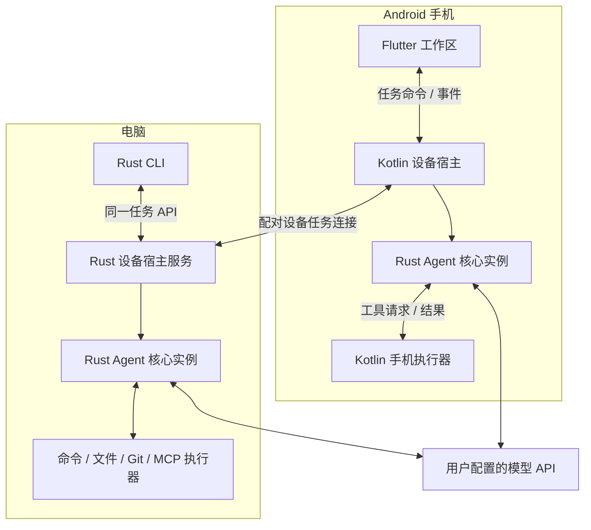

# Expert Chat V2：共享 Agent 核心架构

日期：2026-10-22。状态：**整体重构的当前规划，尚未实现，也未替换正在运行的旧版本。** 实施顺序见 [V2 重建计划](../plans/AGENT-V2-REBUILD.md)。

## 1. 为什么调整方案

原方案围绕现有 Flutter 应用逐步抽出 Dart 任务模块，再新增 Rust 电脑运行时，最后评估共享 Rust 核心。这条路径适合渐进增加能力，代价是过渡期存在两套执行逻辑。

V2 按已经明确的产品目标重新组织：Android 优先、手机跨 App 操作、电脑命令/文件 Agent、独立 CLI、手机远程提交和查看电脑任务。**先验证一套 Rust 核心能否服务两端，再围绕它组织产品模块。** Flutter、Kotlin 与 Python 各自已有的价值继续利用；是否复用某段实现由新模块接口和验收结果决定。

整体重构的含义是重新确定职责、数据所有权和运行关系。需要重建的核心按新边界实现，适配得上的业务模块可以迁入，代码改动量不作为完成标准。

MCP、Agent 钩子、Git worktree 和 Git 树均为必做能力，范围与验收见 [开发者工作区](V2-DEVELOPER-WORKSPACE.md)。Git 树同时包含文件状态树和分支/提交关系图。

## 2. 六个一级模块

| 模块 | 职责与所有权 | 技术与边界 |
| --- | --- | --- |
| **工作区与交互** | 会话、任务、资料、学习、创作、科研、代码、设置；代码工作区包含文件状态树、提交图和 worktree 列表 | Flutter/Dart；通过任务客户端提交目标和消费事件，不拥有 Agent 执行循环 |
| **Agent 核心** | 模型协议、上下文预算、任务状态、工具轮次、固定钩子事件点、取消、核验、任务记录 | 一套 Rust 库；手机与电脑使用同一份核心源码，不依赖 Widget 或 Android/Windows UI API |
| **设备宿主** | 启停核心、提供凭据、管理设备生命周期、注册本机能力 | Android 使用 Kotlin 宿主；电脑使用 Rust 服务；每台设备各自持有运行实例 |
| **工具与内容能力** | Android 观察/动作、电脑命令/文件/Git/worktree、钩子脚本、MCP、搜索、文档与媒体 | 执行器按能力实现；原生调用留在对应平台；Python 文档 MCP 继续作为服务 |
| **设备连接** | 配对、身份、能力协商、任务提交、事件续传与产物读取 | 服务于手机到电脑的任务协议；不承载另一套模型推理或任务决策 |
| **数据与迁移** | 任务存储、工作区数据、资产、秘密存储接口、旧数据导入 | 业务所有权明确；转换旧格式后写入新版本副本，不让两端同时写同一数据库文件 |

会话、学习和创作是工作区模块的子域；模型与工具目录是 Agent 核心内部边界。先按以上六个模块理解系统，再在实际复杂度需要时细分，而不是把每个子域都建成 package 或服务。

产品保持手机 App 与电脑 Agent 两个入口、一个共享核心。MCP 是工具接入方式，钩子是核心中的固定执行节点，Git/worktree 是电脑宿主的仓库能力；这些功能不再各建一套服务或执行引擎。

## 3. 目标运行关系



两端的“共享”是复用核心源码、契约和测试语义，运行实例与任务数据库仍各自独立。执行端拥有任务，远程 UI 保留可重建的投影。

## 4. Android 宿主与桥接选择

首选验证链路为：

**Flutter 工作区 → 平台通道 → Kotlin 设备宿主 → Rust 核心库**。

由 Kotlin 宿主统一持有核心实例并管理 Android 生命周期，Android 执行器也由这个宿主提供。Flutter 消费任务事件；不另外创建第二个 Rust 实例与原生服务争抢同一任务。

Flutter 与 Kotlin 使用平台通道，Rust 与 Kotlin 优先验证 UniFFI 绑定；若异步回调、取消或打包不能满足实测要求，再针对桥接层评估薄 JNI 方案。桥接在 V0 选定，不在正式实现中并行维护多套可选后端。

首个技术验证必须覆盖：模型增量批量传输、Kotlin 工具回调、取消跨语言任务、Activity 重建、App 进程被终止后的记录恢复。成功后才扩大 Rust 移植范围。前台服务受 Android 平台规则约束；使用原生宿主不意味着任务可以无限后台运行。

依据：[Flutter 平台通道](https://docs.flutter.dev/platform-integration/platform-channels)、[UniFFI](https://mozilla.github.io/uniffi-rs/latest/)、[Android 前台服务](https://developer.android.com/develop/background-work/services/fgs)。这些文档证明接口机制可用，不代替本项目的设备实测。

## 5. 第一版项目组织

以下是规划目录，当前未创建 V2 源码工程。

```text
v2/
├── apps/
│   └── mobile/                 # Flutter 手机应用；含 Kotlin 原生宿主/执行器
│       └── lib/workspaces/     # 会话、任务、资料、学习、创作、科研、代码/Git、设置
├── rust/
│   ├── agent-core/             # 公共 Rust 库
│   │   └── src/
│   │       ├── runtime/        # 任务状态、调度、取消
│   │       ├── models/         # 协议适配、自动尝试、流式处理
│   │       ├── tools/          # 工具目录、执行接口与结果
│   │       ├── hooks/          # 固定任务/工具事件点与执行顺序
│   │       ├── context/        # 通用上下文与预算
│   │       ├── storage/        # 任务记录与日志
│   │       └── bindings/       # 实际需要的跨语言接口
│   └── desktop-agent/          # 使用 agent-core 的电脑宿主
│       └── src/
│           ├── bin/           # 服务入口和 CLI 入口
│           ├── executors/     # 电脑命令、文件、Git/worktree、MCP、钩子脚本
│           └── connection/    # 远程任务接入
└── verification/               # 契约样例、端到端场景、数据迁移样本
```

初始两个 Rust crate 对应两个真实使用边界：需要编译给 Android 和电脑共用的库，以及只在电脑运行的宿主/CLI。模型、存储、工具等先作为库内部模块，不分别建立 crate。文档服务直接复用现有 `server/mcp_server` 与 `server/document_core`，不复制进 V2 目录。

## 6. 从旧项目带走什么

| 当前能力 | V2 处理方式 | 验收重点 |
| --- | --- | --- |
| 四协议、自动尝试、签名与工具往返 | 迁为 Rust 模型模块；旧 Dart 实现作行为参考 | 同一人工请求/响应样例得到一致语义；开始输出后不跨协议重发 |
| 任务预算、流式生命周期、停止与恢复 | 按 Rust 核心重建；复用已验证的规则与失败场景 | UI 生命周期与任务分开；取消和中断不伪装成成功 |
| Flutter 聊天和工作区界面 | 按新任务客户端和业务模块改造；可复用合适组件 | 界面不用读取运行时内部状态，流式与输入体验可验收 |
| 项目、素材、记忆、课程、角色、世界信息 | 按业务所有者迁入工作区；不照搬混合总状态 | 数据、关联、作用域和审核规则保持正确 |
| Android 语音、分享、通知等 | 复用已验证原生能力并按宿主接口整合 | 权限、前后台、停止与 Activity 重建 |
| Android 跨 App 操作 | 新增 Kotlin 执行器 | 观察、动作、回读、权限撤销与停止 |
| SSH/SFTP/tmux | 保留为科研工作区能力，接入明确接口 | 交互会话与自主电脑任务相互独立 |
| Python 文档 MCP | 继续通过 MCP 使用 | 上传/编辑/转换/下载契约和文件完整性 |
| 自定义 MCP 接入 | 按工具接口迁入；电脑支持 stdio/HTTP，手机支持 HTTP 或远程电脑任务 | 发现、调用、资源、取消与现有服务兼容 |
| Agent 钩子、任务 worktree、Git 图形工作区 | 新增核心事件点、电脑仓库能力与 Flutter 代码工作区 | 钩子能阻止动作；任务工作区独立；文件状态与提交图对应真实仓库 |
| 旧 Gateway / AuthService | 独立兼容项；迁移阶段确认实际使用和保留范围 | 不默认接入新核心，也不静默删除仍在使用的数据 |
| React Web 原型 | 继续作参考；不纳入首个 Android + Windows 交付 | 不把原型运行等同于 Agent 产品完成 |

现有 1462 项 Dart 测试是需求与回归场景的重要来源，不能直接计为 Rust V2 的通过数量。旧实现的错误、测试中的实现假设和过度兜底也不能作为兼容要求照搬。

## 7. 数据、配置与恢复边界

- Rust 核心拥有任务、尝试、步骤、任务日志和执行产物清单。Flutter 业务模块拥有会话、课程、角色、资料与用户偏好，通过结果引用关联任务。
- 同一个实体只有一个写入所有者；引入 Rust 不意味着再复制一份会话/课程数据库由两种语言同时维护。
- 模型账户和工具秘密由设备宿主提供安全存储引用；开始任务时取得配置快照，切换 UI 的选中账户不改变正在运行的任务。
- 手机本机任务的资料在开始时形成必要快照或可由原生宿主读取的授权资产引用；运行中的 Rust 任务不依赖 Flutter 页面随时在线返回内容。
- 电脑任务使用电脑已配置的模型与限定工作区。手机配对不自动转移全部 Key、私钥或文件。
- V2 验证阶段使用独立应用身份/数据目录或隔离样本库；首次迁移采用备份导入副本。原数据保留用于核对与回退，不能让开发版直接对现用库执行不可逆升级。
- v15/v16/v17 备份、当前学习档案、记忆文件与资产引用均进入迁移验收。V2 的内部 schema 由实际设计决定，不为了沿用数字假定与旧库结构相同。

## 8. 保持实现规模

优先直接调用、普通任务状态表和有序日志。先用一个实际模型协议和少量工具证明整条链路，随后补齐兼容范围。边界校验在数据进入所属模块时完成；变化中的设备权限与动作前置条件由执行器复查。失败保留原因，有限重试只由一个责任方管理。

模块登记不等于插件平台；两端任务协作不要求消息队列集群、全局事件总线、通用事件溯源、自动跨语言领域模型生成或多种并存桥接。只有实际场景要求且测试能证明收益时再增加机制。

## 9. 与原方案的关系

- [旧模块地图](MODULE-MAP.md) 继续作为现有职责定位参考。
- [任务与设备语义](TASK-AND-DEVICE-CONTRACTS.md) 中的身份、取消、幂等、事件与数据归属原则继续适用；执行主体按本 V2 架构调整。
- [增量演进方案](../plans/AGENT-EVOLUTION.md) 和 [旧目标目录](TARGET-STRUCTURE.md) 作为 V0 技术验证无法通过或决定降低迁移范围时的备选。
- V2 验证通过前，不同时推进两套架构的大规模业务迁移。V2 是否成为正式产品由功能覆盖、数据迁移和设备验收结果决定。
