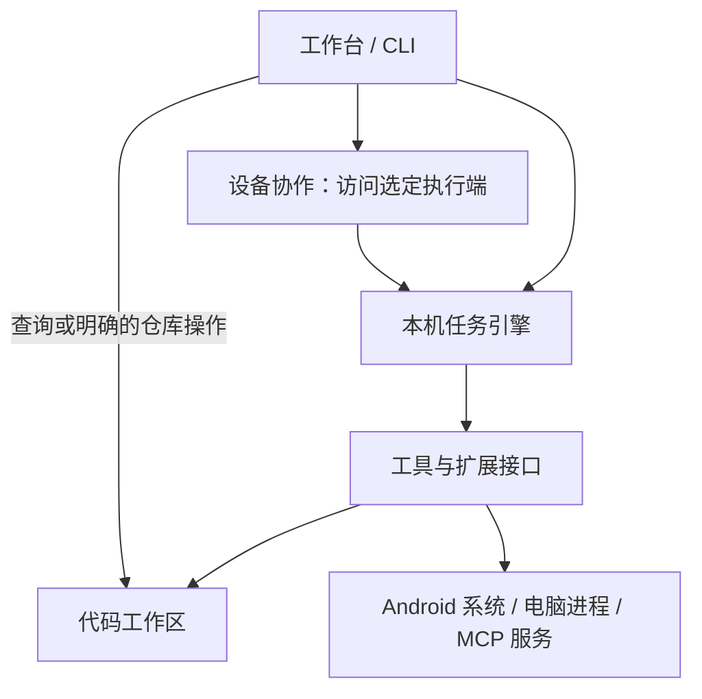
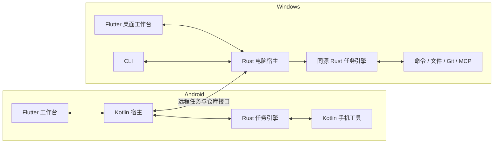

# Expert Chat：手机与电脑协同的 Agent 工作台

更新：2026-10-22。状态：**唯一主规划；电脑工作区与权限基础已开始实现，完整架构尚未完成。** 输入是用户已确认需求和源码检查；旧文档已归档，不作为本方案依据。

电脑任务机制的证据与复用选择见 [编码 Agent 调研](research/DESKTOP-AGENT-RUNTIME.md)，可评测的核心提示见 [提示词草案](prompts/DESKTOP-AGENT.md)。这两份文件细化本计划，不另立实施路线。

## 1. 产品定义

用户可以在手机上对话、处理资料、操作其他 App，也可以把代码或命令任务交给自己的电脑，在手机上查看执行过程、修改和 Git 历史。电脑提供可独立使用的 CLI。

目标交付包括 Android App、Windows 桌面工作台和电脑 Agent/CLI。按用户当前优先级，先贯通电脑工作区与现有会话，再按参考布局重构桌面工作台；Android 跨 App 能力继续保留在主规划中。Linux/macOS 电脑端与 iOS 列为后续范围。

界面围绕三个主要入口组织：**对话与任务、项目工作区、设备与配置**。MCP、钩子、Git 和终端出现在任务或项目的相关位置，不各做一个独立产品。

### 桌面布局方向

用户已提供桌面聊天应用截图作为重构后的布局参考。采用其信息层级与留白，不复制参考图中的私人会话内容。

- 最左侧为窄全局导航栏，放置主入口与设置；次级功能进入对应模块，不堆满常驻按钮。
- 左侧可折叠栏提供新建会话、搜索及“项目 → 会话”树。项目的文件工作区、资料和会话在同一项目入口关联，避免出现两套含义不明的项目列表。
- 主区域保留居中的“聊天／工作”切换。新会话显示简洁引导，已有会话显示消息与任务过程；正文限制阅读宽度，宽屏两侧保留空间。
- 输入框在新会话中处于视觉中心附近，开始对话后靠近内容底部。附件、工具与语音收进输入区的明确入口，不铺开整排开发按钮。
- 工作模式显示当前工作区，未选项目时使用默认工作区；工作区切换与权限入口跟随会话。文件树、差异、Git 图与运行记录按需在右侧展开，不在普通聊天中常驻。
- 窗口变窄时折叠导航或侧栏，保持输入和工作区切换可达；手机界面单独适配，不直接缩小桌面多栏。

第一版桌面布局已落地：窄导航栏、可折叠项目/会话侧栏、居中的聊天/工作切换、居中新会话输入区及会话底部输入区。思考与搜索选项收进输入框菜单，提供明暗主题和窄窗口适配。已有资料项目与代码工作区显示在同一区域，资料项目明确标注类型；两者的数据关联尚未统一。右侧文件树、差异和 Git 图仍为后续工作，当前保留原有大纲等业务面板。

第二轮界面调整：恢复用户原有主题配色；侧栏和搜索结果按聊天/工作分区。工作调用以常驻步骤和结果展示，工作目录以小字置于输入框下方，同一状态区提供上下文查看、缓存命中和费用。上下文快照及统计按会话记录本次打开软件以来的请求；快照保留最近一次请求，不写入历史库。缓存字段缺失不当作零命中，金额或币种缺失显示“未提供”，不套用其他服务价格估算。手机沿用居中模式切换、欢迎页、两行输入区和带底色的附件菜单，保留抽屉导航；Android Agent 能力仍按原计划建设。

### 必须覆盖的使用场景

| 场景 | 用户操作 | 可验收的结果 |
| --- | --- | --- |
| 接入模型 | 填写地址、密钥和模型，选择自动或指定协议 | 识别受支持的协议并正常流式对话；显示真实错误 |
| 电脑代码任务 | 选择仓库，描述修改，查看过程 | 独立 worktree 中修改、运行检查，返回文件差异和执行证据 |
| 工具扩展 | 配置 MCP 服务并选定任务可用工具 | 发现、调用工具，使用资源，查看结果与失败原因 |
| 执行钩子 | 为任务或项目设置检查、格式化和通知 | 在明确的事件点执行，失败行为可预期且可查看 |
| Git 工作区 | 打开项目的代码视图 | 文件状态树、分支/提交图、worktree 与任务关联可见 |
| 手机跨 App | 在 Android 发起观察、点击、输入、切换应用等任务 | 在真实设备上执行并回读结果，可随时停止 |
| 手机远程电脑 | 选择电脑，发起、查看、停止任务 | 手机离线不终止电脑任务；重连回到原任务 |
| 延续已有产品 | 使用会话、资料、学习、创作、语音和科研功能 | 分批迁入，正式替代旧版前明确每项覆盖情况 |

“类似编码 Agent”的效果需要模型能力、上下文组织、工具和结果核验共同达到。MCP、钩子和 Rust 本身不代表任务质量已经达标；用真实代码任务验证效果。

## 2. 五个模块及其责任

模块是职责边界，初期不要求分别建立包、进程或服务。

| 模块 | 负责什么 | 拥有什么 | 提供给其他模块 |
| --- | --- | --- | --- |
| **工作台** | 会话、任务展示、项目资料、学习、创作、语音及设置交互 | 业务内容、用户偏好和内容关联 | 提交任务、呈现事件、引用任务结果 |
| **任务引擎** | 模型接入、上下文与缓存策略、工具循环、有限子任务、预算、取消、状态、钩子触发时序 | 执行端的任务记录、步骤与结果清单 | 提交/查询/取消任务、订阅事件 |
| **工具与扩展** | 内置工具、MCP、系统动作和钩子执行 | 工具定义、连接配置、执行进程/句柄 | 能力清单、执行与取消、结构化结果 |
| **代码工作区** | 仓库、文件状态、差异、分支、worktree、提交历史 | 仓库与任务工作区绑定；Git 是仓库状态的事实来源 | 准备工作区、查询仓库、暂存/提交/合并等明确操作 |
| **设备协作** | 设备配对、能力查询、远程任务提交与事件续传 | 设备身份、连接配置和远程任务引用 | 访问指定设备上的任务及代码工作区 |

学习、创作和科研是工作台内的业务模块。各自管理业务规则，通过任务引擎使用模型与工具，不再把全部业务逻辑挂在聊天控制器上。

### 调用与依赖方向



这张图表达逻辑调用。手机访问电脑仓库时经过设备协作；不会让手机直接读取电脑数据库。任务引擎依赖工具接口，具体平台实现由执行端注册；核心不依赖 Flutter 或 Android UI。结果通过事件返回，执行器不反向调用页面或发起第二套模型循环。

工作台和任务引擎各自拥有的数据只由各自接口写入。任务引擎的手机实例与电脑实例各有存储；会话通过任务引用关联结果，不共享跨设备数据库文件。

## 3. 产品部署与技术选择

| 部分 | 本方案选择 | 原因与约束 |
| --- | --- | --- |
| 手机及桌面工作台 | Flutter / Dart | 当前已有两端界面与大量业务能力；按平台布局适配，按新模块迁入。Windows 工作台连接电脑宿主 |
| Android 系统能力与宿主 | Kotlin | 持有本机执行实例，接系统服务、权限、界面观察和操作 |
| 共用任务引擎 | Rust 库，优先验证 Rig 组件复用 | 电脑 CLI 与手机本机任务使用同一套任务、协议和工具循环；以两端原型与现成方案对照结果为门槛 |
| 电脑 Agent 与 CLI | Rust 程序 | 管理任务、进程、文件、Git、MCP 和远程连接；CLI 通过本机接口操作同一个宿主 |
| 文档处理 | 复用现有 Python 服务 | 作为可配置的 MCP 能力，普通聊天与代码任务不依赖它启动 |

React 不进入首期主链；现有 Web 原型保留为独立实验。当前选择是基于手机优先和现有资产的取舍，不是对其他技术的能力判断。

先验证成熟实现的复用范围：Rust 方案优先组合 Rig 与官方 Rust MCP SDK，电脑端以 OpenCode 的独立服务作对照。若整套复用的成本与质量更合适，再明确修订共享 Rust 引擎的选择；不为保留技术设想重复实现已有能力。Git、包缓存和编译缓存交给现成工具。候选能力、适配缺口与原型门槛见调研第 2 节；目前未安装或采用这些新依赖。



Flutter 与 Kotlin 使用平台通道，Kotlin 与 Rust 首先验证 UniFFI。Kotlin 持有本机核心实例，页面只提交任务和订阅事件。电脑宿主同时服务 CLI 与手机连接。以上是待验证的工程选择，机制依据见 [Flutter 平台通道](https://docs.flutter.dev/platform-integration/platform-channels) 和 [UniFFI 文档](https://mozilla.github.io/uniffi-rs/latest/)。

如果桥接、取消或生命周期验证不通过，先修订该选择，再开始业务迁移；不并行维护两个长期任务引擎。Android 进程被系统结束后保留中断记录，不能承诺无限后台执行。

## 4. 四项开发者能力如何落地

### MCP

电脑支持 stdio 与 HTTP 服务，手机支持 HTTP 服务；依赖电脑本地进程的 MCP 随电脑任务运行。首版覆盖能力发现、工具调用、资源读取、取消和错误显示；资源或工具是否可用按服务声明处理。[MCP 架构说明](https://modelcontextprotocol.io/docs/learn/architecture)。

配置展示服务所属设备、启动参数或地址、凭据引用与可用工具。用户级配置和项目配置覆盖关系明确；运行任务使用启动时选定的配置。协议适配根据实际服务协商，现有自定义文档服务兼容性单独验收，不把一个硬编码版本当作全部 MCP 服务。

内置工具与 MCP 工具进入同一任务循环。涉及文件的 MCP 必须能指向任务 worktree；客户端指定工作目录不会自动限制远程服务权限。

### 钩子

固定支持：**任务开始、工具执行前、工具执行后、任务验收前、任务结束**。配置只包含事件、筛选、动作/命令、超时和失败处理。执行前允许阻止动作，验收失败不能标记成功；结束通知失败记录为通知失败，不篡改已产生的任务结果。

电脑钩子在任务工作目录执行脚本；Android 通过宿主提供可支持的动作，不把桌面 shell 当作手机能力。项目附带脚本由用户启用后使用。钩子共享任务日志和取消入口，重连不重跑历史钩子，脚本引发的动作不递归触发同一钩子。

Git 的原生钩子仍由 Git 触发。应用显示其输出，失败时不自动绕过。无需为这些固定事件建立通用工作流语言。

### Worktree

代码修改任务默认从选定提交建立任务分支和 worktree；只读分析无需新建。任务绑定设备、仓库、worktree、分支和基准提交，命令、文件和钩子使用同一绑定。

同一 worktree 首期只允许一个活动写任务，多个修改任务使用独立 worktree。用户未提交改动不默认复制；若任务需要它们，明确选择要带入的改动。失败保留结果，清理不强制丢弃未提交或未保留的工作。worktree 隔离工作目录，同时共享部分 Git 数据，并不是进程沙箱。[Git worktree 文档](https://git-scm.com/docs/git-worktree)。

### Git 树

| 视图 | 内容与交互 |
| --- | --- |
| 文件状态树 | 文件目录、已修改/新增/删除/未跟踪、暂存/未暂存；查看差异、暂存和取消暂存 |
| 分支与提交图 | 提交父子关系、分支、标签、HEAD 与合并；查看历史和比较差异 |
| Worktree 列表 | 所在设备、路径、分支、关联任务、运行状态与未提交修改 |

电脑调用系统 Git 得到结构化状态，Flutter 绘制图形，CLI 展示相应文本信息。手机看电脑仓库无需先克隆一份。提交和合并是明确的仓库动作；任务完成不会自动触发推送。外部 Git 操作后可刷新，历史按需加载并标记不完整范围。

## 5. 手机操作与远程协作

本机任务使用 Android 工具观察界面、点击、输入、滚动和切换 App，再回读观察确认结果。首期在两个自有演示 App 上验证完整链路，再扩展实际应用。窗口缺乏可访问节点、受保护画面和权限撤销都需要明确结果，不宣称任意 App 都能操作。[Android 无障碍服务机制](https://developer.android.com/guide/topics/ui/accessibility/service)。

发行渠道与跨 App 使用方式在真机原型阶段评估，发布前依据渠道政策确定可交付范围；技术验证成功不等同于商店批准。

远程任务选择电脑后，由该电脑持有任务和配置，手机提供操作界面。第一版先在局域网或用户已有安全网络上连接，使用配对和受保护的连接；不在首期加入自建公网中继。手机配对不自动转移模型密钥或整个资料库。

同一提交标识对应同一任务；手机断连后查询原任务，按事件位置续传，不重复执行命令。取消以执行端确认状态为准；进程重启后如实标记中断，未确认的外部副作用先核验。首期每项任务固定一个执行设备，手机与电脑协作通过关联任务完成，不在任务中途自动迁移运行实例。

## 6. 模型接入与任务行为

首期兼容范围明确为 Chat Completions、Responses、Anthropic Messages、Gemini 原生四种协议。自动模式在已支持的适配器中选择与尝试，用户可以手动固定；不承诺自动理解任意未知私有协议。

只在明确的协议不兼容且尚未输出时尝试其他协议；鉴权失败、限流、超时或已产生部分结果不触发跨协议重发。开始工具往返后保持协议一致。任务的工具能力、预算、执行设备和工作目录在开始时确定。

任务引擎负责“模型提出动作 → 执行 → 回读结果 → 继续或结束”。错误保留原因，重试只由一个明确责任方决定，避免各层重复兜底。共享状态记录和有序事件即可满足首期需求。

### 电脑开发任务的运行约定

- 核心提示和基础工具定义保持版本稳定，运行信息与工具结果追加在后部；缓存参数按供应商、模型和 API 能力适配。观测缓存读/写和总成本，不以命中率单独判断优化成功。
- 保存完整事件与日志，模型按需获取文件与相关输出。先限制长工具输出，再在预算需要时减少旧观察和压缩任务状态；保留目标、约束、改动、验证与运行中任务。
- 单代理作为基线；独立检索、审查和实现才派遣子代理。首个原型限制并发与派遣深度，精简交接，写入任务使用独立 worktree，主代理整合后验证。
- 保留每任务的工作区和增量构建状态，共享包下载及经验证的编译缓存。钩子改动后的测试证据必须对应最终代码；不默认 clean 或重复安装依赖。
- 所有机制采用统一工程任务对照有效完成率、端到端时间和全体调用费用，详见调研第 10 节。

## 7. 目标目录与迁入方式

以下目录表示目标模块归属。当前已创建 `next/desktop` 与 `next/verification`，其他部分仍为规划。新实现先在 `next/` 验证，原应用继续维护；验收切换后再决定是否提升为根目录布局。

```text
next/
├── app/                         # Flutter 工作台
│   ├── lib/workspaces/          # 对话、项目、代码视图、学习、创作、科研
│   ├── lib/task_client/         # 向本机宿主提交任务、订阅事件
│   └── android/                 # Kotlin 宿主与系统工具
├── engine/                      # 一个共享 Rust crate
│   └── src/                     # 任务、模型、上下文、工具接口、钩子时序、任务存储
├── desktop/                     # 一个 Rust 宿主 crate，含 CLI 与服务入口
│   └── src/                     # 本机工具、MCP 进程、仓库/worktree、远程连接
└── verification/                # 人工协议样例、设备场景、迁移样本
```

工具接口在核心，Android 实现在 Kotlin 宿主，电脑实现在 desktop；可复用的 HTTP MCP 适配可放核心内部。代码工作区的 Git 执行只在电脑，图形视图在工作台。这里的目录不意味着把每个模块再拆为独立 crate。

现有 Python 文档服务保持原路径，通过 MCP 接入。现有 React 实验工程、Gateway/AuthService 不默认成为新主链依赖；正式替代旧版本前核对实际使用范围并决定保留方式。

### 当前资产的处理

| 当前来源 | 重构决定 |
| --- | --- |
| `lib/features` 的业务页面 | 按用户工作区复用或调整，接新任务客户端 |
| `lib/state/chat_controller.dart` 及其分部 | 执行逻辑迁入引擎，业务状态回归各自工作区，不整体复制控制器 |
| `lib/domain/llm`、`lib/domain/mcp` | 作为行为和兼容场景参考；Rust 实现用同一组独立样例核对 |
| `lib/domain/study`、`story`、`memory` 与 `lib/data` | 保留有效业务规则，按所属业务迁入；数据转换单独验证 |
| Android 原生分享、通知等 | 可复用的适配接入新宿主；跨 App 执行器新增 |
| SSH/SFTP/tmux | 保留科研交互能力；与电脑 Agent 的自主任务分别提供入口 |
| 现有测试 | 用作行为证据和回归场景，不把旧测试数量当作新工程已通过 |

## 8. 实施顺序与完成条件

不按目录依次搬文件，按用户能完成的任务交付。各阶段的任务/数据接口在同一主规划下调整。

| 阶段 | 交付内容 | 进入下一阶段的条件 |
| --- | --- | --- |
| **1. 两端最小贯通** | 验证现成组件复用；Android 工作台、Kotlin 宿主、Rust 候选核心、Windows 入口；一个协议、一次工具调用与用量记录 | 两端流式、工具、取消与生命周期正确；完成 OpenCode 电脑对照，选定复用路线与桥接 |
| **2. 电脑开发任务** | CLI、文件/命令、MCP、固定钩子、worktree、Git 查询；编码提示、上下文/缓存与有限子代理 | 修改与测试闭环；工作区不互相覆盖；钩子与 MCP 正确；单代理/子代理、上下文和缓存对照有证据 |
| **3. 手机远程工作区** | 配对、远程任务、事件续传、文件树、提交图、worktree 列表与基本 Git 操作 | 手机发起任务，离线五分钟后恢复同一结果；图形与真实 Git 状态一致；能查看差异、暂存、提交；取消状态真实 |
| **4. Android 跨 App** | 观察、动作、回读、停止、权限生命周期 | 两个演示 App 上三条完整任务可重复完成；权限撤销/界面变化可解释；停止后不再派发新动作；确定发行范围 |
| **5. 产品迁入与切换** | 四协议、会话/资料/语音/学习/创作/科研、配置和备份导入、安装包 | 功能覆盖逐项核对；旧数据导入副本并可回退；Android + Windows 完整场景通过后切换 |

阶段 1 同时做最小 Android 观察/动作可行性试验，尽早发现系统能力或发行问题；阶段 4 才建设完整产品体验。阶段 3、4 在接口稳定后可独立推进，不要求先建设分布式调度平台。

阶段 5 按“会话与配置 → 项目/资料/记忆 → 语音 → 学习/创作 → 科研”迁入。每个工作区均保留样本输入、预期输出、迁移结果和失败恢复证据。未迁入功能明确标注，不静默删除。

数据导入写新版本副本，保留原库、文件与关联用于核对。API 密钥交给各设备安全存储；业务数据库不与任务引擎抢写同一实体。新版本通过前不修改现用库结构。

## 9. 控制复杂度

首期采用单机宿主、直接接口、普通任务状态与事件记录。先解决实际错误处理、取消、工作区归属与结果核验。暂不建设插件市场、自定义工作流语言、多 Agent 调度平台、云端账户体系、全量跨设备同步或消息队列集群。

有限子代理是现有任务引擎内的父子任务关系，不单独建立调度平台。原型先限制为主代理加最多两个子代理、派遣一层，再根据真实任务证据调整。成熟组件先验证后复用，仅补足本项目的设备、工作区和业务边界。

每新增一个包、服务或抽象，先指出它解决的已出现问题；仅有“未来可能需要”不足以拆分。模块验收关注用户能否完成任务，不以目录数量、语言数量或重写代码量衡量。

## 10. 当前完成范围

已归档原文档，完成模块规划、运行机制调研与 HTML 框图。按用户要求，先实现电脑执行端的工作区和权限基础，入口见 [电脑工作区 CLI](../next/desktop/README.md)。

已实现：注册/查看/移除工作区，目录级只读/读写/拒绝与额外目录授权，运行时检查和即时撤销，带版本检查的文件修改，以及绑定单个工作区的 stdio MCP 服务。Windows 界面已加入“工具 → 电脑工作区”，通过本地 CLI 共用执行端配置，构建时自动打包执行端。现有 Flutter 工作循环已接入本机命令和 SSH 工作区，以及请求批准、模型辅助批准、完全访问三档策略。命令以系统或 SSH 账号权限执行，工作目录不是进程沙箱；本机含只读/拒绝规则时不开放任意命令。

会话“工作”模式已接入该文件服务：未选项目时自动使用应用专用默认工作区，可按会话切换已登记项目；模型工具调用和结果回送复用现有会话执行循环。绑定只存本机，任务执行中固定目标，权限仍由 Rust 实时检查。

桌面外壳已按参考布局重构。全局导航、项目/会话导航和当前会话分层展示；从代码项目新建会话自动绑定工作区，全局新会话回到聊天模式，之后开启工作模式即使用默认工作区。侧栏折叠和页面切换保留当前会话及草稿，手机继续使用原有抽屉入口。

这不表示阶段 1 或阶段 2 已全部通过。共享 Rust 模型引擎尚未实现；后续验证命令隔离后端及 Agent 组件复用，再接入自主构建/测试和手机界面。没有迁移旧业务目录或用户数据库。

## 11. 工作台补齐计划与本轮分工

按用户要求分派三个子代理并行实施，主代理负责现有工作循环、权限与页面入口的接线。沿用当前 Flutter/Dart 执行链，不在这一轮同时迁移语言或数据库。

| 批次 | 模块与交付 | 责任划分 | 完成条件 |
| --- | --- | --- | --- |
| **本轮首批** | 文件改动清单、逐行 diff、版本校验撤销 | change_review 子代理；主代理接文件工具记录 | 本机/SSH 文件工具写入后可查看改动；撤销仍检查原目标与版本 |
| **本轮首批** | 任务状态、实时 stdout/stderr、停止入口与最小执行记录 | task_runtime 子代理；主代理接审批与命令流 | 可识别执行中/等待批准/结束；重启未完成任务标为中断 |
| **本轮首批** | 文件树、文本预览、Git 状态/diff/分支/提交父子关系、worktree 列表及创建 | git_workspace 子代理；主代理核验工作区授权 | 用户在统一工作台浏览；创建前明确展示分支和目标路径 |
| **下一批** | 固定工具前后钩子、应用内有限子代理、多模型选择、worktree 任务绑定 | 在上述执行事件与工作区接口上扩展 | 主代理可派遣最多两个独立子任务、回收结果；写入任务各用独立工作树，不自动合并/推送 |
| **后续** | 后台进程与持久化任务队列、断线查询和事件续传 | 执行端负责任务，界面订阅状态 | 退出界面不等于任务消失；重启后可区分可恢复与需人工核验的任务 |
| **最后接入** | 手机远程工作台与 Android 本机动作 | 复用任务/工作区接口，Android 宿主执行设备动作 | 手机查看真实文件改动、日志、审批与任务状态 |

首批范围：快照跟踪文件工具的文本写入，不覆盖任意命令的全部文件副作用。已存在文件可按最新 hash 撤销；新增文件暂不提供删除式撤销。Git 视图和 worktree 创建先支持本机；SSH 提供文件浏览、写入与实时命令日志。worktree 创建不自动注册授权、不自动提交、合并或推送。执行记录持久化，实时日志仅保留本次运行的有界尾部；不宣称已经实现进程跨重启续跑。

本轮按用户要求不追加测试套件或全量验证；子代理提交模块后，由主代理完成必要代码整合与 Windows 编译，修正编译阻断后打开软件。

## 12. 2026-10-23 用户追加需求与实施批次

本节记录之后的明确要求，覆盖上文早期原型限制。用户此前要求只记录；现已授权派多个代理开始实施。保留当前 Flutter/Dart 主链和已有用户数据，不同时做执行引擎重写。当前一次集成只交付可核验的第一批，其余事项保留为待办，不能把设计或配置入口称为功能完成。

### 第一批：代码已集成，Windows Release 构建通过

- 运行可靠性：区分等待后台结果、完成、失败和停止；完成/停止后迟到事件不能启动新任务。错误提示可关闭，不改变真实任务结果；网络错误根因需按实际请求诊断，不能靠隐藏卡片宣称修复网络。
- 并发：每个工作任务内部按配置限制子代理并发，独立工作会话不共用全局任务数量上限。保留深度和直属子代理数量限制。
- 界面：普通聊天不显示工作目录、执行位置与工作权限；长模型名可读；项目/MCP/模型弹层具有内部留白、视口边距和有界滚动；状态栏主题自适应；长执行记录方便折叠。
- 会话侧栏：工作视图可筛选“正在进行”，程序按最近执行活动排序并节流；不是人工拖动。运行中显示动态标识，完成绿点、待人确认橙点、错误红点。
- 最终交付：文件变更与最终交付清单分离；只有主代理明确登记、实际读到的最终成果进入交付区。保存版本标识，后续修改使旧登记失效；不把全部写入、日志和调试产物自动当成交付。
- 默认指令：提供直接可用的主代理和各子代理角色指令，设置页展示默认内容、允许修改与恢复；不覆盖已保存的用户指令。权限、停止和容量由代码执行，不交给提示词兜底。
- 浏览器：基于官方 Playwright 能力提供可选接入、依赖提示、按会话隔离的模型操作和生命周期管理。页面导航、读取、点击、输入、截图及控制台/网络诊断依赖实际发现的工具；外部受控浏览器与嵌入 WebView 的关联程度必须如实说明。

### 第二批：上下文、工具与质量基础（待实施）

- 调研论文与原始实现，再设计主动压缩、关键约束保留、版本化检查点、历史检索/恢复，以及主子代理上下文交接。当前本地摘录不等于完整工作记忆。
- 记录少量任务关键规则，针对修改后状态失效、独立数据身份冲突、损坏恢复等跨操作情形做检查。验收证据绑定最终产物版本，不以测试数量或子代理“已完成”声明代替证据。
- 工具管理：发现、按需加载、安装/更新、依赖诊断与权限管理；数学工具包括精确计算、符号/数值计算、统计、绘图及结论验证。
- 检查点与恢复：保护用户编辑的按轮回退、逐文件/逐块审阅，恢复已完成与未确认操作时避免重复副作用；程序重启后的任务续接必须有执行记录支持。
- 浏览器与工作台贯通：展示受控页面和操作状态、用户接手、选中页面元素反馈、截图/日志回传；不能以独立 MCP 窗口冒充内嵌浏览器联动。
- 任务计划、运行中补充要求、待生效设置和暂停/停止具有明确状态；文件/终端/浏览器/变更始终归属正确会话。多代理共享项目增加职责划分、冲突检测与适用时的独立工作树。

### 第三批：模型服务、监督与角色积累（待实施）

- 参考 https://github.com/yetone/magpie 的模型、渠道、账号、路由分层。以模型为主要入口，Base URL/密钥或订阅登录后扫描模型；同模型多渠道优先级可拖动，独立管理 Auto/备用模型策略、额度、故障恢复与路由记录。订阅能力逐项验证，不从参考项目宣传推定已可用。
- 可选监督模型：观察目标、公开计划、工具事件与产物，按能力缺口、重复失败和关键交付触发。工具建议由程序鉴权、当前工具轮结束后生效；建议绑定执行版本以丢弃过时意见，不依赖完整思维链。比较有无监督的质量、延迟、成本与无效干预。
- 角色积累：找不到合适角色时先检索现有角色和资料，再创建待验证角色，试用与验收后进入可复用库。保存来源、范围、验证结果和版本；用户能修改/禁用/删除/回退，自动更新不覆盖用户改写。继续遵守模型池、权限、并发和递归限制。

### 后续基础能力（待实施，不以后台托盘替代）

- 执行端独立于界面的持久化任务、远程连接与断线续传、可复用项目环境。
- 定时/文件/仓库/外部事件自动化，明确触发原因、去重、暂停和运行历史。
- 综合工具与插件管理，以及最终成果的多文件项目组织和必要依赖打包。

第一批由 runtime_reliability、ui_polish、browser_capability 三个子代理并行，主代理负责交付清单、默认指令、集成审查和定向检查。不得重置已有未提交修改，也不得为更新程序中断正在进行的用户任务。

#### 第一批检查结果与边界

- 已通过针对任务续跑/停止/关闭错误竞态、独立任务并发、浏览器会话隔离、交付清单版本与恢复、默认指令编辑和界面布局的定向检查。发现并修复 shell 在 LayoutBuilder 布局阶段移动 GlobalKey 子树导致的 Tooltip/OverlayPortal 缩放断言。
- 使用实际 Dart MCP 客户端和官方 Playwright MCP 0.0.83，在隔离的无头 Edge 中验证本地页面导航、输入、点击、截图、控制台、网络和双会话状态隔离；没有接管用户已登录的浏览器。
- Playwright 为可选 MCP 预设，需要 Node.js 与对应浏览器。当前使用独立浏览器，尚未联动工作台 WebView；子代理可读页面快照，子代理自身的截图视觉回传仍待完善。
- 交付登记复用权限检查后的文件读取，支持当前文件服务上限内的二进制（8 MiB）；二进制及过大文本不伪造增删行。登记后本轮再次执行任意 shell 命令会保守撤回交付选择，需重新登记；不是对外部进程任意改动的实时文件监控。
- “正在进行”的活动排序每 5 秒最多更新一次，完成项保留在当前侧栏实例内；排序历史尚未持久化。
- 连接错误卡片可关闭且不改变执行结论；没有以关闭卡片替代用户所报真实网络故障的诊断。部分旧 UI 测试仍使用此前已删除控件的断言，未宣称全量测试通过。

### 后续修复：首次响应等待与运行日志

根据用户实际失败记录：一次工具后续请求在 30 秒响应头等待处超时，另一次只保存了泛化的“网络连接中断”，无法还原底层原因。已增加以下实现：

- 工作主代理和子代理的模型响应头等待默认 120 秒，设置 → 能力 → 模型响应等待可在 30–600 秒调整。使用原有任务预算 JSON 保存，旧设置缺省自动采用 120 秒。主任务在完整工具轮边界应用新设置；普通聊天保持协议适配器默认值。
- OpenAI Chat、Responses、Anthropic Messages 和 Gemini Native 四种协议均读取客户端请求级超时；该设置不进入上游请求正文，固定渠道也不会固定旧的等待时间。连接建立、流式空闲和任务总预算仍分别计算。
- 超时错误保留“等待响应头／流式空闲”与等待上限；连接错误保留 Dio 类型、服务主机、底层异常类型和可用的系统错误码。未知非传输异常不再一律称为网络中断，不记录任意异常的请求/响应正文。
- 新增工作台“日志”页与运行中入口。按会话显示主/子代理请求、首个响应、工具、进程和状态事件，支持全部/错误筛选、展开诊断、复制和导出 JSONL。用户上翻阅读时暂停自动跟随。
- 本地日志保留 7 天，每会话 200 条、全局 1500 条且总数据约 1 MiB 内；错误即时排队保存，其余事件合并保存。敏感值脱敏，不保存提示词、工具参数、文件正文或响应正文；日志损坏/保存失败不阻断执行。旧错误不能事后补录原始信息。
- 已通过四协议慢响应测试、超时设置继承/持久化/轮次边界测试、错误分类与脱敏、日志保留与恢复、窄屏筛选与滚动检查。没有对用户付费模型发送重放请求。
- 命令执行详情改为命令、退出状态、输出的分区展示，解码 JSON 中的命令字符串，使用等宽字体保留对齐；支持复制、换行/横向滚动，其他参数折叠。只按已知输出格式分离 stderr，不臆造退出码或错误流。
- 新建本机交互终端默认优先 PowerShell 7（含 Windows Store 执行别名），没有 pwsh 时退回 Windows PowerShell；保留 Shell 自身的补全、历史和 profile。已用真实 ConPTY 验证本机 PowerShell 7 输入与 Tab 补全。已有终端及模型命令执行器不被热切换，SSH 沿用远端 Shell。
- 用户正在执行任务时，不重启旧程序。此轮 Windows 包构建至 `output/releases/timeout-logs`；完成后恢复常规 CMake 输出配置，避免改写正在运行的 Release 包。

### 2026-10-24 追加：思考显示翻译

用户随后明确要求实施。翻译作为 UI 显示层：从服务商已返回的原始思考段落读取文字，独立请求所选翻译模型，不改写 ChatMessage.reasoning、主/子代理请求历史或工具事件的原始偏移。

- 展开思考/执行记录后，可选择已配置模型或跟随当前会话，显式点击翻译；支持原文、中文、对照，窄屏上下对照，宽屏并排。
- 运行中按稳定片段增量翻译；缓存键包含源文本哈希、模型/提供商和翻译提示版本，已完成片段复用。未译尾部标明原文，停止翻译不停止工作，界面刷新不自动恢复已停止的翻译。
- 公式和代码通过保护片段原样恢复；不完整响应、模型请求工具或占位符缺失视为翻译失败，保留原文且不缓存失败输出。选择新模型时不把旧模型译文当成新译文展示。
- 译文侧缓存有容量/时间限制，与消息及上下文分开；删除会话取消相关翻译并清理派生缓存。翻译额外用量独立展示并计入辅助用量，缺失统计不伪装成零。运行日志记录翻译请求的阶段与脱敏诊断，不记录原文/译文正文。
- 用户现有任务运行期间继续使用独立 Windows 交付目录 `output/releases/thinking-translation`，不覆盖或关闭运行中的旧版本。
- 实施检查完成：翻译后端 5 项、相关界面 10 项定向测试通过，Windows Release 暂存构建成功，常规 CMake 输出路径已恢复。检查使用模拟翻译模型，没有向用户的付费服务提交测试翻译请求。

后续终端配色修正：PSReadLine 默认发送 ANSI 37/93/92 等明确颜色，单独把终端背景改成浅色会导致白字和亮黄色输入难以辨认。工作台及科研终端共享的调色板现按主题明暗选择；浅色使用深色语义高亮，深色保留亮色，搜索选区随主题调整。没有修改 PowerShell profile。已检查实际 PSReadLine 颜色码、输入颜色对比度和明暗预览。

## 13. 2026-10-24 全部剩余需求实施与验收台账

本轮用户授权完成全部剩余需求，沿用现有 Flutter/Dart 主执行链与 Rust 文件权限边界。主代理仅监督；三个实施代理负责代码、文档、测试和构建。运行中的用户程序、真实项目、密钥和会话不得作为验证夹具。

| 里程碑 | 实施归属 | 具体交付与验收门槛 | 当前状态 |
| --- | --- | --- | --- |
| A1 长任务工作记忆 | context_execution | 模型可保存版本化约束/计划/压缩摘要，可检索并取回原始历史；压缩不删除持久历史，跨会话身份隔离，重启可恢复 | 已实现；完整客户端检查及定向隔离/恢复检查通过 |
| A2 安全执行与审阅 | context_execution | 工具派发前持久记录，完成/未知结果可区分；未知副作用需明确续接，禁止盲目重放；按轮检查点、版本保护回退和块审阅 | 已实现；定向与本机权限夹具通过 |
| A3 协作与交付 | context_execution | 子代理职责/文件归属冲突检测、适用时独立 worktree、集成验收；大文件/二进制清单不全量读入，目录与压缩包需明确最终登记 | 已实现；脏 Git 工程、回退/重建与大文件夹具通过 |
| B1 模型服务与监督 | models_tools | 模型/渠道/账号/路由、发现与诊断、故障恢复与路由记录；监督意见绑定执行版本并在轮边界生效 | 已实现；模拟协议/路由与监督检查通过，账号激活另验 |
| B2 工具与角色 | models_tools | 工具按需发现/加载、依赖安装诊断、数学计算验证；角色来源/范围/验证/版本与用户修改保护 | 已实现；数学/注册表/角色及真实 Playwright 夹具通过 |
| C1 手机远程工作台 | mobile_remote | 远程配对/续传/工作台入口；真实设备能力单独验收 | 已实现；TLS/断线/宿主及前轮原生真链路通过；最终 Android 运行复验环境阻断（见末尾） |
| C2 执行端与自动化 | mobile_remote | 脱离界面的持久任务状态、可复用环境、触发原因/去重/暂停/历史；明确进程实际生命周期 | 已实现；独立宿主/触发/权限/预算夹具通过 |
| 集成验收 | 三实施代理，主代理监督 | 共享文件窄接口协调；Flutter 测试/构建串行；模拟模型与隔离本地工程验证正常、取消、迟到、损坏与重启序列；产物版本对应证据 | 实现、完整客户端/桌面检查及三正式包构建/验签/哈希完成；最终 Android 运行复验环境阻断 |

状态使用“已实现 / 已验证 / 外部阻塞”分别记录，配置入口、设计或缺少真机证据不计作完成。账号登录、付费模型、Android 权限和设备等外部条件如不可用，保留可执行接口与明确阻塞记录，不虚报验证。

### 长任务记忆调研与设计依据

[MemGPT 原论文](https://arxiv.org/abs/2310.08560)提出通过显式工具在有限上下文与外部记忆间调页。本项目采用可调用的写入、检索与回读接口，而不是把本地截断称作长期记忆。[Anthropic 原始工程说明](https://www.anthropic.com/engineering/effective-context-engineering-for-ai-agents)介绍压缩、结构化笔记与多代理上下文；本项目将约束、公开计划、摘要与原始历史分开保存。[官方可执行示例](https://platform.claude.com/cookbook/tool-use-context-engineering-context-engineering-tools)分别演示压缩、工具结果清理和持久记忆；据此，摘要用于当前请求，历史用于可追溯回读，不能让摘要覆盖原始证据。这些来源提供设计依据，不能代替本产品测试。


### 逐功能验收补充（不得被里程碑总项覆盖）

- A：主动模型摘要与本地摘录分别标识；约束和公开计划固定保留；历史关键词/消息 ID/片段偏移回读，主子代理交接不跨会话泄漏。
- A：逐工具写前日志、重复调用抑制、未知结果用户确认；按轮文件检查点与逐块审阅，回退前验证当前版本且保护用户编辑。
- A：多代理声明文件职责与冲突检测，独立 worktree 接线和集成验收证据；大型/二进制最终清单使用元数据哈希；目录/归档显式登记而非全部写入自动交付；侧栏活动持久化。
- B：模型/渠道/账号/路由优先级、模型扫描、Auto/备用/额度与恢复记录；监督的执行版本与轮次边界；角色检索、试用、验证、版本及用户改写保护；默认提示仍可编辑和恢复。
- B：工具发现/按需加载/安装更新/依赖诊断/权限；数学精确/符号/数值/统计/图形与结论验证；浏览器工作台关联、接手、元素反馈、截图和诊断实际回传。
- C：手机远程目标任务而不止命令、配对、断线事件游标、审批/停止与结果；任务执行不依赖页面；项目环境复用；定时/文件/仓库/外部触发去重、暂停、历史。
- C：Android 本机观察/动作/权限撤销/停止后不派发；APK 构建和真实设备任务证据分别记录，缺设备则明确外部阻塞。

调研链接已打开核对：MemGPT v2 摘要与作者/发表信息、Anthropic 2025-09-29 工程正文、2026-03-20 官方 Cookbook 代码说明。当前新增 `work_memory_checkpoint` 由主模型写公开摘要，区别于旧 700-token 本地摘录；原始消息仍由会话存储负责，不能用新摘要覆盖原文。上下文窗口清理和自动触发策略仍须单独验收。

### A 工作流阶段记录（历史，已由以下逐项验收表替代）

早期检查点先完成记忆/操作日志，再接入按轮回退、独立树和交付。早期“待 Flutter 验证”“不支持删除新文件”“独立树仍在实施”等描述现已失效：后续已实现新文件安全删除与不覆盖重建、脏 Git 基线隔离、实际 UI 恢复回调和大型成果元数据操作；以下表格及末尾实际检查记录为当前状态。历史定向检查先后为 9 项、四文件 30 项，不作为最终全量验收替代。

### 3.8.0+4112 逐项验收收敛记录

下表覆盖本轮剩余功能，不把“已实现”“已验证”“外部条件未验证”合并为一句完成声明。最终客户端全量检查、Windows 暂存包和签名 APK 另在交付记录补记。

| 功能 | 实现与实际验证 | 限制或外部条件 |
| --- | --- | --- |
| 主/子代理工作记忆 | 按会话及宿主确定的 agent ID 分开 CAS；子代理只读主任务交接与用户固定约束，不能改写主/兄弟笔记；主代理可指定 scope 回读。失败不发布版本，损坏时保护约束并经来源哈希核验、保留损坏副本后重建 | 笔记不是权限；不保存隐藏思维链。单字段有界，不能宣称无限全文记忆 |
| 主动/自动压缩与原始回读 | 主/子循环在本地裁剪前按实际历史上限或约 72% token 压力请求公开检查点；每任务最多 2 次、间隔 4 轮、30 秒、输入不超过有效预算及 12k UTF-8 字节、输出最多 1000 tokens；来源/版本变更丢弃；固定原始用户目标及用户 pins 单独计入预算；存在模型可调用压缩/历史来源与片段偏移工具 | 使用既有自动上下文开关；原始目标超过辅助请求 4000 字节或辅助预算不足时不额外调用，保留手动压缩和本地预算；工具历史沿用有界 64k 字符记录，超长正文须从授权原目标补读。额外用量单列，未报告不伪装为零 |
| 公开计划、补充方向、暂停/停止 | 日志页可查看计划、摘要、版本和用户专属固定约束。运行中“补充任务”产生持久回执与真实用户消息，下一个完整轮次准备后确认；保留原始目标、同一根任务/额度，子代理也接收；停止取消未生效队列。主/子完整轮次边界可暂停/继续，侧栏/底栏区分待暂停与已停止派发新轮次 | 不把工具完成事件提升为用户目标；已提交命令/服务继续，不声称冻结 OS 进程；任务结束后须显式新用户消息开始后续工作 |
| 安全续接与执行记录 | 外部副作用派发前持久记录，绑定会话/代理/请求/调用 ID，区分已完成与未知；未知阻止新的外部变更但允许只读检查。用户只核验对话框展示的精确身份，新出现未知记录不被顺带解除；全局损坏须核验来源摘要 | 不自动重放旧命令；原 Flutter 任务重启后以中断/需核验对待，不冒充已迁入独立执行端。终态有界保留，未确认记录不淘汰，执行日志不备份为可运行队列 |
| 按轮、文件、块审阅与回退 | 相同工具轮连续写入合并；跨轮保留独立基线；整轮倒序逐文件核验，冲突停止并报告部分完成。逐块回退保留未选择行的原始 CR/LF 字节。新文件经明确名单确认、当前哈希检查后删除，原快照可按 expected=new 重新创建，已有用户替换文件不覆盖 | 仅追踪有完整前后文本快照的文件工具；不承诺回滚任意 Shell、外部服务或未知二进制副作用。SSH 新文件回退使用远端 Python3；未用真实 SSH 账户做在线验收 |
| 文件版本保护 | Rust 对替换/删除/复制的版本哈希加入稳定长度/时间/文件身份检查、可行的文件锁及提交前重验；确定性外部原子保存竞态测试保留用户新文件 | 属于写入前版本校验与乐观冲突保护，不宣称对任意不协作外部编辑器建立跨进程原子事务 |
| 多代理职责与隔离 | 缺省只读；写任务需明确 false 与 owned_paths 或 isolated；重叠/非法声明在分配名额前拒绝，只读后代不可扩大权限，未知外部变更、文档编辑、页面提交/设备点击均不能绕过只读角色。独立树位于授权根内，保留脏文本/二进制及未忽略的未跟踪文件精确基线；不 stash/reset，不创建独立权限泄漏 | 基线最多 1000 路径；忽略的未跟踪内容不擅自复制。任意命令仍是账号权限、不是进程沙箱；独立树每次重新核验原父授权，父权限收紧则拒绝。托管目录不触发自身 Hooks/普通 Git 改动/父目录最终清单递归 |
| 验收后整合 | 父代理拿到可在原授权根读取的前缀路径；显式逐文件整合要求结束的子任务、已读源哈希与原始父基线均匹配，冲突不写；不自动合并、提交或推送 | 当前安全整合工具为 UTF-8 文本；二进制/整个目录可作为最终成果登记而不自动覆盖父项目 |
| 大型/二进制/目录/归档交付 | 最终清单与普通变更分离，只有显式登记进入交付；本机按 64KiB 分块哈希，不把大文件正文读入上下文；完整目录清单有数量/深度/权限/链接/变动检查。目录、9MiB 文件、隔离前缀的打开所在目录均走元数据而非 base64，打开时验证登记版本；别名/目录后代变更撤销旧选择 | 目录清单最多 1000 条、深度 32；过界/变化拒绝，不伪造文本增删行；外部实时文件监控不宣称存在，但再次打开/登记会核验 |
| 侧栏与默认指令 | 活动排序时间本地有界持久化，保留五秒节流；启动不把已完成任务伪装成新活动。新版默认说明记忆、原始回读、按需工具、写职责、隔离/整合与最新用户补充，已保存自定义指令仍保留 | 排序/执行记录归属会话，不变成全局共享任务上限 |
| 模型服务与路由 | 模型主要入口、同模型渠道优先级、Auto/备用路由组、账户凭据隔离与缺失失效处理、路由记录及配置备份；协议/缺失凭据/路由夹具与界面检查通过 | 真实订阅登录及供应商支持逐项依赖用户账号；Magpie 为可选外部组件，须明确配置路径/依赖并手动启动，不静默登录或发现 |
| 监督与角色积累 | 监督只读公开目标/计划/工具结果/产物版本，轮次边界建议经程序鉴权，过时丢弃，用量/延迟/干预记录可见。角色先检索资料与库，再提案、真实受限试用、版本/工具证据核验；默认人工，模型验收和自动加入需分别明确启用；原用户角色不覆盖，支持修订/禁用/删除/回退 | 模拟测试不能证明真实模型质量提升；使用真实付费模型的质量/成本对照未执行，缺用量明确未知 |
| 工具、数学、浏览器 | 配置内工具可检索/申请，在下一完整轮加载且撤销生效；依赖诊断与可信安装/更新入口；数学精确/符号/数值/统计/绘图/验证采用白名单后端。受控 Playwright 与人工网页明确分开，接手、反馈、截图/日志与传输队列撤销实际接线，子代理视觉按自身所选模型判断 | 可选 Python/SymPy/Node/浏览器依赖需实际安装启用；旧会话/当前工具轮不热切换。未知 MCP 读写提示不作为只读授权 |
| 独立宿主、远程与自动化 | 独立 Dart 宿主可执行目标模型/工具循环与命令，持久记录/未知状态/事件游标、配对 TLS、断线续传、固定项目环境；定时/文件/Git/外部事件触发记录原因、去重、暂停、历史；远程三档授权与预算/加轮有实测夹具 | 旧 Flutter 本地任务不自动迁移；远程主机账号命令不是 Rust 子目录沙箱，不谎称继承本机拒绝/只读规则。真实网络/供应商账号仍需用户配置 |
| Android 本机动作 | 独立新模拟器上两 App、观察版本/窗口/目标检查、停止/撤权、真实通知 STOP、持有者释放及下一任务、截图尺寸/缩放/全屏坐标元数据实际验证；主/子模型截图回传与不同视觉能力组合通过控制器检查 | 前轮独立模拟器验证已通过；最终原生重验在应用安装前受 AVD 系统镜像崩溃阻断，未加载测试，不计为最终重验通过。厂商真机/发行渠道仍需另验；权限与本次控制只能由用户开启，模型不能 arm 或打开权限设置 |
| 配置与安全备份 | 新模型/监督/角色/工具用户配置进入设置备份，完整备份保留现有用户能力配置优先；工作记忆/pins 随复制会话重新映射 ID，原副本不覆盖。补充正文按用户消息归档；凭据、操作日志、可运行队列及设备/浏览器租约不导入为自动执行 | 导入前要求任务完成或由用户手动停止，避免重建控制器中断现有任务；未知/旧状态不会静默续跑 |

验收证据：定向 21 文件共 101 项通过；交叉审查修正后 6 文件 40 项通过，包含真实 Windows Git/Rust 脏基线与 UI→恢复回调；原始执行日志在本轮 `output/` 验证目录。Rust 完整 17 项及 clippy `-D warnings` 通过。后续格式/全量静态检查/全量测试和最终包必须追加实际结果，不能以此前定向结果代替。


### 最终源码检查（2026-10-24，冻结快照）

- `python scripts/check.py --scope client`：通过；749 个 Dart 文件格式零改动，`flutter analyze --no-pub` 零问题，`flutter test --no-pub --coverage` 1692 项全部通过，总用时 127.84 秒。结果 `output/checks/client.json` / `output/client-required-final.log`。根分析排除独立 vendored `third_party`，未禁用本项目规则或删除有效回归。
- `python scripts/check.py --scope desktop`：通过；Rust fmt、clippy `-D warnings`、17 项测试、构建及 5 项真实 MCP 黑盒检查；结果 `output/checks/desktop.json`。真实脏 Git 工程、9MiB 清单、变动拒绝和无覆盖恢复另有定向证据。
- 全量收敛中发现并修正：原子凭据配对/失败回滚、辅助验收首 await 前及请求中停止、模型视觉切换、真实用户补充来源、物理路径职责别名、文档/搜索/视觉步骤身份、侧栏迟到导航、故事启动误停其他会话、未使用设备会话的多余原生清理、宿主关闭时等待已启动的自动化扫描。旧界面/持久设置夹具按实际入口更新，保留关键行为断言；没有恢复用户已删除的独立提示词预设。
- 独立宿主最终生命周期修正后 32 项纯 Dart 检查、短 TLS 实测、编译 EXE 通过；Android 原生链路以前轮独立模拟器为证据，最终重验按末尾环境阻断记录。最终便携 ZIP/签名 APK 和哈希见下方实际产物记录，不以源码检查代替构建成功。
- 本轮不创建新 commit、tag、push 或 main merge；源码保留在当前分支工作区。运行中的旧应用不停止、不替换，构建输出使用新的独立目录。


### Android 最终运行验证边界

最终源码复验期间，专用 `emulator-5580` 在应用安装/测试加载前出现 PackageManager/SystemServer 失败；对本轮创建的 AVD 清除数据冷启动后，仍出现系统镜像 CRC/GZIP/protobuf/libart 错误与 SIGSEGV。最后一次有依据的单核隔离冷启动同样在安装任何自有 APK 前失败，已停止该自有 AVD，不再同条件重复尝试。证据留在 `output/device-agent-evidence/final-verification.txt`，不放入交付包。

因此必须区分：完整客户端 1692 项通过；前轮 fake LLM→真实 ChatController→Android 原生观察/动作/真实 PNG→下一模型请求已有通过证据（3 次模型请求，1080×2400→921×2048 坐标元数据，另含真实通知 STOP/撤权/租约验收）；**最终源码的原生重验和最终 APK 安装启动 smoke 属于外部环境阻断，不能冒称通过**。正常 main.dart Release 编译与签名核验独立记录，不以编译代替运行验证。程序源码与已核验 Windows/宿主包保持冻结。


### 3.8.0+4112 最终交付

三个正式包已冻结，目录 `output/delivery/3.8.0+4112/` 仅交付包、简明说明和校验清单，不放验证日志/截图、凭据、用户资料或测试夹具。

| 产物 | 实际字节数 | SHA-256 |
| --- | ---: | --- |
| `expert-chat-windows-v3.8.0.zip` | 35151804 | `9E975D936CBA84AA80970C8D35D5072FE23B3B5C991C4E14422E98F4E4631EAE` |
| `expert-chat-android-v3.8.0.apk` | 116152225 | `D9E2DA6EE53B97F8C7E38829EF198951E202057F49190E4381158566E6F26623` |
| `expert-chat-remote-host-v3.8.0.zip` | 3685140 | `E5CA2EE6253EF5DC16F5598FB621712E9B0DF4D8EB89F6BA4EF92BA21727B3B6` |

Windows Release 107.8 秒成功，EXE FileVersion/ProductVersion 均为 3.8.0+4112；相邻 `expert-desktop.exe --help` 正常。构建 target 为 `lib/main.dart`；`data/app.so` 与本次 `build/windows/app.so` SHA 相同，时间位于本次构建区间，确认正式 AOT。新暂存目录与两份旧版运行路径分离，旧运行程序二进制哈希未变；临时 CMake 输出路径原文恢复。最终 ZIP 的 65 个文件与内部 manifest 逐项 SHA/长度一致，未启动新版 UI。最终纯文件清点发现并排除共享 assets 遗留的 kernel_blob、vm/isolate snapshot、last_build_id 四个 debug 生成物；旧 74,944,649 字节/0C8C... ZIP 已移出交付目录并作废，正式 icudtl 和声明 assets 保留。

Android 正常 `lib/main.dart` Release 250.3 秒成功；APK versionName=3.8.0、versionCode=4112，minSdk=24、targetSdk=36，MainActivity、三 ABI AOT。v2 签名有效，证书 SHA-256 `EB452EF00BA962A9A95152702600F28ACE043E0B229B4D99DE8198257BFA45D2` 与历史正式包一致；无 debuggable/testOnly/instrumentation、kernel_blob、integration_test 或 fixture 条目。Release 再生成时只去除 ignored 注册文件遗留的 integration_test 引用，没有加入生产测试依赖或清理共享 build。最终安装启动/原生重验仍按上节环境阻断记录，不冒称运行通过。

独立宿主最后生命周期修正后，32 项纯 Dart 检查、EXE 编译、实际短 TLS 复验通过。正式 ZIP 仅宿主、可信数学 worker、版本 manifest 与说明。真实订阅账号/付费模型质量成本、实际 SSH 回退、managed SymPy 安装到用户 AppData、厂商 Android 真机与发行渠道仍由实际外部环境验收。

统一说明为 `output/delivery/3.8.0+4112/START-HERE.md`，文件校验为 `SHA256SUMS.txt` / `release-manifest.json`。程序源码没有新提交/推送/main 合并；HEAD 仍 eb9c142。
源码统计：含新增未跟踪源码，共 238 文件；已跟踪 138 文件 +7543/-1261，新增未跟踪 100 个文本文件 +17164 行，无新增二进制；合计 +24707/-1261 行。排除 ignored 构建/证据/交付文件。


## 14. 3.8.1+4113 桌面数学工具记录补丁

范围仅修复新调用的记录生命周期：数学、按需注册表、角色/记忆等内置能力原先返回结果但没有专属步骤记录，统一收尾误建“失败/未执行”占位项，运行日志随之误记 skipped。新增宿主创建的调用步骤与结果绑定，不修改数学计算后端、权限或原历史会话。

验收门槛：实际 controller 经工具检索/申请/完整轮边界后执行本地可信 Python 数学；1/3+1/6 保存为已完成且结果 1/2，toolName、调用 ID、已脱敏参数与结束时间可从真实 SQLite 重新读取。验证不能判定（equal=null）仍是执行完成；后端错误、抛出、取消、未激活/拒绝、未知结果分别保留真实状态。复用 provider call ID、无 call ID、并发相同参数不得串写当前或旧步骤；宿主 activity ID 存在时只匹配精确新步骤。敏感参数脱敏后不得被原始参数回填。

B 实施、A 只读交叉审查与集成/Windows 打包，root 只监督。当前版本 3.8.1+4113；不重建 Android/独立宿主、不操作坏 AVD、不改用户配置/报告/历史、不终止或替换运行中的 3.8.0、不自动打开修正版、不创建提交或推送。完整 client、独立 Windows 正式 main 构建与干净包核验已通过，实际结果如下。


### 14.1 验收与 Windows 交付结果

- B 定向回归 43/43 通过，其中新增 10 项真实 controller/SQLite 生命周期回归，包含可信本地 Python 成功值、equal=null、失败/抛出/取消/未激活/拒绝/未知结果、缺失 ID 与重复 ID，以及并发子代理相同参数倒序完成不串写。
- `python scripts/check.py --scope client` 完整通过：750 个 Dart 文件格式零修改，`flutter analyze --no-pub` 零诊断，1702/1702 测试通过，149.47 秒。证据 `output/math-records-3.8.1/client-required.log`。
- Windows `lib/main.dart` 正式 Release 104.2 秒成功；FileVersion/ProductVersion 均为 3.8.1+4113。新目录与当前 3.8.0 运行目录分离，旧运行二进制哈希不变，临时 CMake 输出设置原文恢复；没有启动新 UI。
- 正式 AOT 与本次 `build/windows/app.so` SHA 相同、在构建区间生成且不同于 3.8.0；`icudtl.dat`、声明 assets 与原生 helper 保留。排除 kernel_blob、vm/isolate snapshot、last_build_id 四类 debug 生成物；ZIP CRC 与 65 个文件逐项 SHA/长度全部通过，共 66 entries。
- 只交付 Windows 修正版，不重新构建 Android 或独立宿主；无 Rust 源码变更，不重复桌面大检查。既有 3.8.0 三包保持原样。
- 旧历史、缺失工具参数、用户报告与配置没有回填或改写；本次只使新调用记录正确。源码不提交、不推送、不合并 main。

最终 Windows 包：`output/delivery/3.8.1+4113/expert-chat-windows-v3.8.1.zip`，35154870 字节，SHA-256 `91796A16E56002B3F51AF4DA7AB6A4CE7A912AC52BDAF9FCF1878B2C7D693856`。

说明与校验：同目录 `START-HERE.md`、`SHA256SUMS.txt`、`release-manifest.json`。

## 15. 2026-10-25 P0 + P1 界面改版与交付验收

状态：**完整P0视觉和P1布局导航已实现、全量检查及监督目视通过，Windows与签名Android包已独立交付。** 本轮基于开始时已包含大量未提交修改的工作树，未回退/覆盖原改动；每个既有目标文件改前副本保存在 `output/redesign-review/baseline/`。下表仅归因本轮UI变动，不把既有远程、数学、角色、模型等后端能力算作本轮新实现。

### 规范与入口覆盖

- §2、§4.4、§4.13–4.14：统一token和状态动效、子代理胶囊、交付文字按钮、审批样式、八套艺术配色及自适应图标。
- §3、§4.1–4.12：四个一级入口；工作/聊天同时分组与固定底栏；顶栏/输入/用量/轮次；三类工作台；全层级回到对话；真实自动化汇总；五类资料库与四类设置。
- 聊天/工作仍通过 `switchConversationMode` 新开独立会话，不给已有会话换类型，不转移工作区或工具授权。宽度仍默认560、范围340到clamp(可用宽度−430,340,900)，低于820不停靠；桌面主区不足820整页打开，手机窗口不足840才78%底部工作台。
- 原入口→新入口逐项表：[导航/设置/资料库](../output/redesign-review/navigation-entry-map.md)、[对话/工作台](../output/redesign-review/chat-workbench-entry-map.md)。[覆盖核对](../output/redesign-review/mapping-coverage.md)按当前清单241行核对，181名称直匹配、60行组合映射均有归属；该数字不是全部后端在线实测数量。

### 本轮逐文件改法

| 文件 | 本轮变动 |
|---|---|
| `android/app/src/main/res/mipmap-anydpi-v26/ic_expert_chat.xml` | 为原有效ic_expert_chat资源增加自适应前景/背景声明。 |
| `android/app/src/main/res/mipmap-hdpi/ic_expert_chat_foreground.png` | 同源生成透明安全区角色前景；旧有效legacy位图不变。 |
| `android/app/src/main/res/mipmap-mdpi/ic_expert_chat_foreground.png` | 同源生成透明安全区角色前景；旧有效legacy位图不变。 |
| `android/app/src/main/res/mipmap-xhdpi/ic_expert_chat_foreground.png` | 同源生成透明安全区角色前景；旧有效legacy位图不变。 |
| `android/app/src/main/res/mipmap-xxhdpi/ic_expert_chat_foreground.png` | 同源生成透明安全区角色前景；旧有效legacy位图不变。 |
| `android/app/src/main/res/mipmap-xxxhdpi/ic_expert_chat_foreground.png` | 同源生成透明安全区角色前景；旧有效legacy位图不变。 |
| `android/app/src/main/res/values/expert_chat_icon.xml` | 为自适应启动图标提供独立青色背景。 |
| `lib/core/theme.dart` | 集中间距/动效/触控与状态色 token，追加八套艺术色，统一正文和字体 fallback，冻结原十四套色值。 |
| `lib/data/ui_prefs.dart` | 新增艺术色枚举、工作台宽度和分组折叠 JSON；校验非法宽度、隔离可变数组并兼容旧排版值。 |
| `lib/domain/workbench/processes/work_hook_runtime.dart` | 为自动化页复用真实手动运行与原会话工作区授权，避免旧错误冒充新执行失败。 |
| `lib/features/chat/chat_page.dart` | 重组顶栏、固定输入区、轮次/补充任务和手机审批；按窗口及可用宽度区分停靠、整页和底部工作台。 |
| `lib/features/chat/chat_workspace_sidebar.dart` | 工作/聊天及启用的创作学习同屏分组，固定底部导航，持久折叠并冻结悬停重排。 |
| `lib/features/chat/widgets/chat_composer.dart` | 将位置/资料集/权限/模型思考/用量收进固定输入区，保留托盘全部动作与语音发送语义。 |
| `lib/features/chat/widgets/chat_dataset_control.dart` | 新增真实资料集引用芯片，复用项目仓库与assignProject。 |
| `lib/features/chat/widgets/chat_work_mode_switch.dart` | 统一居中外观和44触控目标，继续使用独立新会话的切换回调。 |
| `lib/features/chat/widgets/chat_workspace_options.dart` | 统一默认/本机/SSH选择器及管理入口，远程电脑和Android仍明确跳专页。 |
| `lib/features/chat/widgets/composer_model_picker.dart` | 合并模型和思考强度弹层，保留Auto、路由组和模型搜索。 |
| `lib/features/chat/widgets/composer_popover.dart` | 手机采用底部弹层、桌面有界popover，并保证标题留白和底部动作可达。 |
| `lib/features/chat/widgets/composer_tool_tray.dart` | 保留附件与高级托盘项目，只删除未渲染的联网搜索死参数。 |
| `lib/features/chat/widgets/conversation_execution_indicator.dart` | 复用统一状态动效及共享未读判定，不在非对话页误标已查看。 |
| `lib/features/chat/widgets/conversation_history_list.dart` | 保留行菜单、归档、多选与搜索跳转，并适配浅层来源高亮。 |
| `lib/features/chat/widgets/conversation_mode_filter.dart` | 按§6确认无引用后删除闲置组件。 |
| `lib/features/chat/widgets/execution_ring.dart` | 保留旧构造接口，改用12像素/2像素/0.8秒的共享运行指示。 |
| `lib/features/chat/widgets/execution_status_indicator.dart` | 新增共享圆环/呼吸/完成/失败及胶囊，真正停用和恢复动画控制器。 |
| `lib/features/chat/widgets/message_bubble.dart` | 默认用户浅气泡、助手无外框阴影，正文14且保留文档样式和全部消息动作。 |
| `lib/features/chat/widgets/session_policy_controls.dart` | 以带模式名的权限芯片和三张说明卡呈现既有会话权限，保留高级策略。 |
| `lib/features/chat/widgets/sidebar_reorder_motion.dart` | 新增按key的280毫秒位移动画，并支持减少动效静态呈现。 |
| `lib/features/chat/widgets/streaming_markdown.dart` | 正文统一14与1.7新默认，继续遵循文字缩放及Markdown风格偏好。 |
| `lib/features/chat/widgets/thinking_panel.dart` | 减少动效时真正停止循环ticker，保留思考、翻译及步骤操作。 |
| `lib/features/chat/widgets/work_approval_card.dart` | 确认色浅底/30%边框、完整等宽参数和中文fallback；手机审批双按钮等宽44。 |
| `lib/features/chat/widgets/work_delivery_files.dart` | 每个交付文件提供预览及打开/复制位置文字按钮，原版本和权限检查不变。 |
| `lib/features/chat/widgets/work_round_controls.dart` | 提供真实暂停/继续/加轮/补充/停止及终态续轮；手机状态完整、动作单行可横向滚动。 |
| `lib/features/chat/widgets/work_session_footer.dart` | 将真实上下文、缓存、费用和快照合入用量环，并标记直达设置路由以保留返回入口。 |
| `lib/features/library/generation_history_page.dart` | 支持资料库内嵌，去重复标题但保留记录、对比和再生成操作。 |
| `lib/features/library/resources_page.dart` | 建立资料集/素材/生图记录/学习/创作五标签，并保留开关与真实二级页面。 |
| `lib/features/projects/projects_page.dart` | 界面改称资料集，显示文件数并可强制新建引用聊天；内嵌时不重复AppBar。 |
| `lib/features/remote/remote_automation_panel.dart` | 现有触发器改全宽卡和独立动作行，复用共享防重请求状态。 |
| `lib/features/remote/remote_tasks_page.dart` | 保留配对/任务/审批/成果原页，并共享自动化幂等调用状态。 |
| `lib/features/settings/settings_page.dart` | 重组四分类，迁入单价、功能开关等入口并保留原配置组件和一处关于。 |
| `lib/features/settings/widgets/appearance_settings_widgets.dart` | 艺术/原有配色分组和来源色块；预览使用真实主题并继承字体。 |
| `lib/features/settings/widgets/model_settings_widgets.dart` | 仅删除无引用ProfileSelector/ProfileEditPage及专属导入，保留预设、余额和用量组件。 |
| `lib/features/settings/widgets/reading_appearance_settings.dart` | 明确恢复默认采用1.7，已保存阅读数值不被改写。 |
| `lib/features/shell/app_shell.dart` | 移除64窄rail，统一侧栏四入口并保留页面状态、抽屉和桌面返回胶囊。 |
| `lib/features/shell/automation_page.dart` | 汇总已有远程触发器和本地文件Hooks，保留配置/运行/重连并支持长命令可读卡片。 |
| `lib/features/shell/automation_status.dart` | 展示真实已启用自动化数量，未连接远程不伪装成零。 |
| `lib/features/shell/conversation_return_scope.dart` | 统一根页/辅助设置路由和深层返回入口，遵守模态/输入焦点/PopScope且同route重试有界。 |
| `lib/features/shell/desktop_navigation_rail.dart` | 按P1确认无引用后删除旧窄导航组件。 |
| `lib/features/shell/return_to_conversation.dart` | 呈现真实会话标题、状态和其他任务，稳定路由回调回到原会话。 |
| `lib/features/shell/shell_tab.dart` | 一级入口改对话/自动化/资料库/设置，旧可选页面保留语义映射和开关。 |
| `lib/features/shell/tools_page.dart` | 保留二级工具及模块功能，更新已迁移入口与草稿返回行为。 |
| `lib/features/workbench/agents/agent_cluster_card.dart` | 真实状态显示运行/排队/完成胶囊，减少动效停止ticker且保留树折叠。 |
| `lib/features/workbench/agents/work_agents_panel.dart` | 抽出限制编辑器；工作台隐藏重复配置头，独立调用默认仍显示，集群/取消/追加能力保留。 |
| `lib/features/workbench/changes/work_changes_page.dart` | 窄屏详情整体滚动并惰性绘制diff，加入中文等宽字体fallback，回退保护不变。 |
| `lib/features/workbench/files/workspace_file_tab.dart` | Consolas编辑器补中文fallback，原查看/编辑/预览/保存与冲突处理保持。 |
| `lib/features/workbench/git/git_workspace_page.dart` | 支持新Git二级入口直接进入改动视图，保留提交图和worktree。 |
| `lib/features/workbench/runtime/work_task_panel.dart` | 仅删除无引用WorkTaskStatusBar并保留原WorkTaskPanel；只读轮次在工作台容器呈现。 |
| `lib/features/workbench/workspace_workbench_page.dart` | 八类能力归入改动/运行/助手，保留多实例文件/终端/浏览器和各类空态。 |
| `lib/main.dart` | 在真实 MaterialApp 挂统一路由观察和返回对话 Scope，覆盖设置深层路由。 |
| `lib/state/chat/generation.dart` | 仅接入用户显式续轮的一次性轮数预算，原模型和工具鉴权路径保持。 |
| `lib/state/chat/streaming.dart` | 将一次性轮数预算传给WorkRounds.start；未传参数时沿用原会话策略。 |
| `lib/state/chat/turns.dart` | 新增显式终态继续工作入口，绑定会话ID且不持久改写SessionPolicy。 |
| `lib/state/conversation_attention.dart` | 共享UI未读签名，仅真实回到对话根页才标已查看。 |
| `lib/state/conversation_workspace_bindings.dart` | 新增CAS条件回滚辅助，失败时只回滚仍匹配原写入的绑定；清SSH由UI选择器处理。 |
| `scripts/render_redesign_icons.cjs` | 用既有sharp从同一SVG生成Android自适应前景和Windows多尺寸图标，不新增依赖。 |

### 本轮逐测试文件变动

以下19个既有测试依据改前副本比对，另有11个新测试；未把原用户已有且本轮未改的测试计入。

| 测试文件 | 本轮类型 | 本轮改法/覆盖 |
|---|---|---|
| `test/appearance_palette_test.dart` | 新增 | 新增360宽明暗配色分组与艺术色选择回调测试。 |
| `test/chat_responsive_layout_test.dart` | 基线差异修改 | 更新输入/用量与工作台入口布局断言，保留窄屏、缩放、语音和原业务开关验证。 |
| `test/chat_session_concurrency_test.dart` | 基线差异修改 | 仅将固定等待改为有界真实流状态barrier，保留精确partial、暂停、原目标和root配额断言。 |
| `test/chat_workspace_options_test.dart` | 基线差异修改 | 用新芯片tooltip/选择器核对真实路径，并验证SSH转本机、失败保存和CAS回滚。 |
| `test/composer_controls_test.dart` | 基线差异修改 | 验证合并后的模型思考入口、语音/发送切换和有界思考弹层。 |
| `test/conversation_sidebar_test.dart` | 基线差异修改 | 更新新分组入口并覆盖悬停/菜单排序冻结、折叠保存及原异步选择保护。 |
| `test/desktop_layout_test.dart` | 基线差异修改 | 适配四入口/侧栏和模式位置，保留工作区绑定与真实桌面布局断言。 |
| `test/execution_status_indicator_test.dart` | 新增 | 新增循环动画真正停止/恢复及完成勾/失败叉测试。 |
| `test/full_backup_test.dart` | 基线差异修改 | 补新UI字段显式恢复及默认保留现有偏好，保留原数据库与文件恢复回归。 |
| `test/harness_ui_regressions_test.dart` | 基线差异修改 | 更新已迁移的popover选择器，保留标题留白、内部滚动和底部动作可见性。 |
| `test/redesign_chat_workbench_test.dart` | 新增 | 新增三类工作台/多实例/独立配置入口、轮次补充任务、指标和手柄规则验证。 |
| `test/redesign_navigation_test.dart` | 新增 | 新增四入口、分组状态、深层任务菜单、返回拦截和自动化长卡/防重验证。 |
| `test/redesign_return_drawer_test.dart` | 新增 | 新增抽屉LocalHistory先关闭、Esc和回到对话的真实导航验证。 |
| `test/redesign_settings_route_test.dart` | 新增 | 新增用量环直达设置及子页的返回、普通工作台排除和有界willPop拒绝测试。 |
| `test/redesign_visual_test.dart` | 新增 | 新增真实AppShell八组尺寸主题及键盘/设置/自动化/艺术/子代理渲染与可达边界测试。 |
| `test/research_mode_test.dart` | 基线差异修改 | 按新语义导航映射验证科研/创作开关，保留原开启关闭和会话状态条件。 |
| `test/settings_bundle_test.dart` | 基线差异修改 | 在真实配置迁移中补新配色/宽度/分组字段，保留密钥和网关原断言。 |
| `test/settings_category_navigation_test.dart` | 基线差异修改 | 适配四分类和迁入的配置入口，保留返回与设置状态验证。 |
| `test/study_mode_test.dart` | 基线差异修改 | 按新导航映射验证学习开关，继续检查学习入口显示/隐藏。 |
| `test/theme_contrast_test.dart` | 新增 | 新增22配色×明暗×五对实测，新8严格达标，旧14冻结且逐对防退化。 |
| `test/tools_navigation_test.dart` | 基线差异修改 | 验证工具移入设置后的模块入口与草稿保持。 |
| `test/ui_prefs_test.dart` | 基线差异修改 | 覆盖新枚举/字段JSON、非法宽度、数组隔离及新1.7/旧1.85默认兼容。 |
| `test/user_facing_copy_test.dart` | 基线差异修改 | 更新资料集与新入口文案选择器，保留说明简洁和文档限制可达断言。 |
| `test/widget_test.dart` | 基线差异修改 | 更新模型思考/顶栏选择器，保留原消息、生成和持久化交互断言。 |
| `test/work_approval_card_test.dart` | 新增 | 新增完整原始参数、手机审批按钮及真实批准/拒绝Future回调测试。 |
| `test/work_continuation_test.dart` | 新增 | 新增显式终态续轮ID/预算/错误清理，确认原策略JSON和授权不变。 |
| `test/work_delivery_files_test.dart` | 新增 | 新增360宽本地/SSH与Android/Windows文字动作、预览和Clipboard回调测试。 |
| `test/work_stream_layout_test.dart` | 基线差异修改 | 按新固定输入/用量结构验证长流式任务及hover tooltip转场不溢出。 |
| `test/workspace_browsing_test.dart` | 基线差异修改 | 验证资料库到资料集管理和会话往返，保留真实数据关联。 |
| `test/workspace_visual_test.dart` | 基线差异修改 | 适配新侧栏/设置入口，继续核对草稿保留和回到对话。 |

### 实际验收与来源

| 项目 | 实际结果与证据 |
|---|---|
| 最终全量分析 | `flutter analyze --no-pub` 零问题，exit0；[日志](../output/redesign-review/integration-delivery-analyze.log) |
| 最终全量测试 | `flutter test --no-pub` **1758项全部通过**，exit0；[日志](../output/redesign-review/integration-delivery-test.log) |
| 冻结源 | 1011个源/资源/配置记录；前后变化为空，[源manifest](../output/redesign-review/integration-delivery-sources.json) SHA256 `CDFFA85A1EF9AFE7974D90AAC8A6B068A3EE89723D7752845C287EDED8428207`，与[最终exit](../output/redesign-review/integration-delivery-exit.json)绑定 |
| 界面图 | 360/390/1280/1440×浅深8组，另含键盘300、审批/长路径、设置四类、资料库、自动化远程+本机、艺术色及子代理；[截图目录](../output/redesign-review/screenshots/)。真实Flutter widget夹具渲染，主代理逐图目视通过，不冒称真机或旧运行客户端截图 |
| 数据与回归 | 新偏好JSON/旧缺字段/非法宽度/数组隔离、完整备份默认保留与显式恢复、配置迁移、精确审批/交付回调、动效停启、工作台键盘/拖动/整页与sheet、真实设置深层返回/模态/保存拦截均有测试 |
| CLI | 同一Rust源release边界测试17项通过；最终Windows发布目录内CLI再跑5项真实MCP黑盒通过，仅临时工程，[记录](../output/redesign-review/final-packaged-cli-mcp.log) |
| Windows | 独立副本Release成功；实际捆绑当前源CLI、DLL/data、数学worker，ZIP65文件逐项CRC/SHA验证；[包核对](../output/redesign-review/windows-package-verification.json) |
| Android | 正常release生成注册器后签名APK成功；v2验证、包名/版本、min24/target36、三ABI、无debug/instrumentation/integration_test、数学worker和5密度自适应资源已核验；证书与旧发布APK一致，[核对](../output/redesign-review/android-package-verification.json) |

新测试文件为 `appearance_palette_test.dart`、`execution_status_indicator_test.dart`、`work_approval_card_test.dart`、`work_delivery_files_test.dart`、`theme_contrast_test.dart`、`redesign_visual_test.dart`、`redesign_navigation_test.dart`、`redesign_return_drawer_test.dart`、`redesign_chat_workbench_test.dart`、`redesign_settings_route_test.dart`、`work_continuation_test.dart`。既有入口选择器随布局迁移更新，业务/授权/草稿/原始目标和配额断言保留；旧并发用例的固定等待改为真实流状态barrier，未修改生产运行时来过测。规范“221个测试文件”为历史数，本次实际 `test/` 230文件。11个 `integration_test/` 文件未作为真机安装测试执行；未调用真实付费账号、未将外部设备/服务条件冒充在线验收。

构建源隔离于 `E:\wweiyi\tmp\expert-chat-ui-redesign-build-20261025-022630`，输出独立目录 `E:\wweiyi\Project\Software\expert_chat\output\releases\ui-redesign-20261025-022630`，未改全局Flutter build-dir或原CMake。最初NuGet缓存定位通过本轮子进程PATH复用已有 `.tools/nuget.exe`；APK使用正常pub-enabled release生成器过滤dev插件（`pub get`后`--no-pub`会跳过该步骤），未手改业务源、未把integration_test加入发行依赖。全程依赖锁hash不变，临时签名配置已定向删除，发布目录无私钥/配置密钥。

### 真实差异与能力边界

- 原14套配色色值和minimal默认不变。实测不足4.5的不止solar，共23个旧色对；[全部五对×明暗实测](../output/redesign-review/contrast.json)及[不足清单](../output/redesign-review/legacy-contrast-shortfalls.md)完整留存。新8套全部五对严格≥4.5；旧14冻结并按min(4.5,原比率)防退化，未擅改旧色。
- 既有cornerStyle的8/14/20映射及用户保存的文字/排版偏好保留；新装和明确恢复默认用1.7行高，旧JSON缺lineHeight仍回落旧1.85。新增8/12/18设计token不迁移旧用户选择。
- §4.13艺术色标P1与§5阶段表P0文字不一致；本次完整P0+P1已全部包含。Android/Windows旧有效猫耳图标本已正确，本轮新增Android adaptive层，未把重生成后未变的legacy位图/ICO说成新修复。
- 按§6删除真正无引用的旧rail、模式筛选、页内历史死分支、死搜索参数、WorkTaskStatusBar和两个旧Profile组件。角色库/世界书现由资料库真实引用，保留可达页面；提示词预设存档及未接界面的网关OIDC保持原状。
- UI沿既有能力边界：权限仍会话三模式；远程电脑/Android使用专页；未伪造工具例外、本机定时/Webhook、统一新执行位置、自定义配色或提示词迁移能力。

### 交付与保护

| 产物 | 字节数 | SHA256 |
|---|---:|---|
| [Windows完整ZIP](../output/releases/ui-redesign-20261025-022630/expert-chat-windows-3.8.1+4113-ui.zip) | 34459980 | `242A0452213648ACAB86A3B62555728A40F750F2D2B143ACA7AA54D1673D2998` |
| [Android签名APK](../output/releases/ui-redesign-20261025-022630/expert-chat-android-3.8.1+4113-ui.apk) | 116623533 | `F72494065DE7283A6C12BD5F4A2E5308AEEA4281BA4BBEB5A86CD97067F612B1` |

APK包名`com.wweiyi.expert_chat`，版本`3.8.1/4113`；新旧证书SHA256均为`EB452EF00BA962A9A95152702600F28ACE043E0B229B4D99DE8198257BFA45D2`。同目录提供README、SHA256SUMS、release-manifest和source-manifest。Windows必须整目录解压保留CLI/DLL/data，不能只复制exe。

[最终保护检查](../output/redesign-review/final-safety-source-verification.json)：原PID56776仍运行，路径及二进制hash不变；没有自动启动/安装新客户端。当前UI交付已完成，无待实施的P0/P1项；真实账号/设备仍沿原授权条件。本轮未创建commit/tag/push或线上更新。

## 16. 五项用户反馈修订（2026-10-25）

在已交付HTML视觉版上仅修订五点：窄聊天输入区位置/权限移框外并增加文本留白；模型按实际配置来源分组且保留原同名模型优先级/思考行为；全局子代理模型池与限制/预算迁到设置→助手与技能；角色库说明采用自然高度并与模型分配留距；技能卡保留圆角裁剪与安全内缩，完整展示末项说明。

[本轮报告与逐项说明](../output/ui-feedback-review/FINAL-REPORT.md)、[配置入口迁移表](../output/ui-feedback-review/agent-settings-migration.md)、[模型来源分组语义](../output/ui-feedback-review/model-sources-notes.md)。[完整验证](../output/ui-feedback-review/ui-feedback-pass1-exit.json)：analyze无问题、1796项全部通过，源快照前后变化为空。局部输入/角色/技能Flutter widget渲染及模型分组行为验收通过，没有扩展其它区域目视审查或声称真实用户窗口内容已检查。

新独立发布目录`output/releases/ui-feedback-20261025-120638`：[Windows完整ZIP](../output/releases/ui-feedback-20261025-120638/expert-chat-windows-3.8.1+4113-ui-feedback.zip)、[Android原证书签名APK](../output/releases/ui-feedback-20261025-120638/expert-chat-android-3.8.1+4113-ui-feedback.apk)、[产物/源hash与验证manifest](../output/releases/ui-feedback-20261025-120638/release-manifest.json)。Windows65文件与包内CLI五项黑盒核验通过；Android签名v2及前版证书匹配。新修订版未启动、APK未安装；此前用户请求打开的HTML版PID58528、路径与二进制保持不动。无新依赖、无后端授权或会话模型ID语义变化，原14套配色及选色保留；未提交/推送。

### 后续交付约定：修订后自动打开

用户随后明确要求“每次修订完就自动打开”。本项目后续每次完成修订、验证和独立打包后，自动打开最新 Windows 客户端，不再等待重复的打开指令；若同一可执行文件已经运行，则不重复创建实例。继续遵守不覆盖或擅自停止正在运行版本的约束，Android 不自动安装。

五项反馈修订版已按此要求启动：`ui-feedback-20261025-120638/ExpertChat-3.8.1+4113-Feedback/expert_chat.exe`，PID 32544，窗口标题 `Expert Chat`，窗口已出现且进程正常响应。


## 17. 工作会话运行与桌面行为修订（2026-10-25）

本轮按用户确认仅修六项：新会话默认开启High、仍可调Low/Max或关闭；工作消息左右留白；运行五入口居中换行；同root后台续接带入已保存工具证据；主代理prompt完整编辑移至设置；Windows GUI强制单实例。未新增依赖或后端授权能力。

- 真正fresh聊天/工作以true/High初始化，旧会话cache/run手动值不每次发送重置；原effort字段与数据值保留，散文隐式降Low移除。显式模型和只有普通模型的Auto仍可用，不强发不支持字段；model-only picker不再伪显示关闭。
- 工作消息仅增加按实际pane宽度的32/24自适应padding，原full/wide/narrow和固定留白值不变、正文仍左对齐。居中要求只用于运行任务/终端/浏览器/Services/日志五入口的Wrap；实例缓存、切换、新建和关闭不变。
- 合法后台续接只摘录当前root已保存终态工具数据，保留done/failed和真实错误、明确缺失/截断，并进入原预算；允许输入变化后的验证，不合成用户再次发送、不盲目重放工具，也不保证真实模型永不重复。
- 主代理指令在设置→助手与技能→工作主代理保留原完整保存/恢复字段；工作台保留“编辑主代理指令”真实跳转及设置回到会话保护。
- Windows以跨release目录稳定Local身份防第二GUI，恢复隐藏/最小化窗口、等待有界、guard失败不无保护启动，次进程提示前释放句柄；不停止CLI/执行端。

[最终报告与逐文件/域说明](../output/work-polish-review/FINAL-REPORT.md)。[最终集成](../output/work-polish-review/work-polish-delivery-exit.json)：analyze退出0、1829项全部通过、源快照前后无变化；manifest SHA256为`A4008A3C531A34E32FD87A489D4AF9D8BA2102A0BA80A113F75BEFC81CD44743`。分域覆盖真实参数/Low-Max-off/旧会话、留白与运行入口几何、同root证据和停止防迟到、主指令跳转；Windows native随机隔离身份10场景通过，含并发/跨目录/隐藏最小化/超时/崩溃恢复/类型冲突失败。widget浏览器短错误夹具只证明布局/导航，不当作真实native浏览器启动证据。

用户最新“只允许一个软件打开”覆盖§16此前“不停止运行版本”的并存保护约定：此后更新启动不同版本前先退出旧版；同版重复启动只唤起已有窗口。此次启动前客户端进程为0，无需停止任何客户端。

Windows已完成独立交付并自动打开：[最终完整ZIP](../output/releases/work-polish-20261025-130222/expert-chat-windows-3.8.1+4113-work-polish.zip)，34,502,597字节，SHA256 `6730DE2B5825AFA278A11ECBE54A46E92692421775EBBD47EC01D56621C75B27`。[包核验](../output/work-polish-review/windows-package-verification.json)65文件和随包CLI5项通过，包输入源与最终manifest一致。[真实启动核验](../output/work-polish-review/windows-launch-verification.json)：新PID60484、HWND4921808、Expert Chat响应正常；第二次启动PID54332退出0，全机客户端计数1。启动前计数0、此前两个PID已无进程，本轮未杀客户端；未截真实用户窗口或提交任务，运行的新目录已冻结。

Android也已完成：[签名APK](../output/releases/work-polish-20261025-130222/expert-chat-android-3.8.1+4113-work-polish.apk)，116,868,309字节，SHA256 `9D58A8A536CC99C670FF975256FAA05C2191C9E138BC7434169ADF926F92CE38`；原证书一致、v2签名及三ABI/包内容核验通过，未自动安装。[交付清单](../output/releases/work-polish-20261025-130222/release-manifest.json)与校验和已生成。本轮六项修订及两平台交付全部完成，未提交/推送，未覆盖运行版构建目录。

最终继续交付时此前客户端已退出，按约定自动打开最新包；[最终运行状态](../output/work-polish-review/windows-final-running-state.json)记录 PID 37936、响应正常、客户端计数 1。


## 18. 集中反馈修订（2026-10-25）

按用户连续截图清单一次完成：工具详情参数/结果分区、JSON缩进高亮/目录行与原始复制；模型按实际能力显示思考档位与独立开关；账号卡真实登录状态；可折叠且不同浅底的来源组及真实固定来源请求；工具轮次不再清空可见正文；原型风格紧凑执行列表、状态与收起同排；细线图标与侧栏对齐；SVG/HTML/浏览器适配及手动缩放；仅电脑端设置/资料库/自动化/执行位置应用内大弹窗；右下角可关闭、普通2秒通知且避开录音发送操作；手机紧凑层次和菜单入口；中文任务可见语言指导，保留原文/翻译。

[完整原因与入口/文件映射](../output/refinement-review/FINAL-REPORT.md)记录每项实现、所有初轮失败及修复、逐域测试和渲染证据。原14套配色色值、权限/任务执行边界和数据字段兼容保留；新增模型能力随API服务配置导出导入，完整会话备份沿原安全排除规则。无新增依赖、提交或推送。

[最终全量](../output/refinement-review/refinement-final-exit.json)：analyze无问题、1874项测试全部通过，1036源文件前后无变化。源SHA256 `40AD9BEB4CA0B6BAD10BE3307116C2983178FBBA8A12D14F8E0BD0226945F865`。正文修复含真实controller工具等待、最终持久化及冷重载；手机360/390、电脑1280/1440明暗widget渲染通过，模型控件另12图验证五档/开关/来源展开收起。预览脚本通过独立DOM模型，未伪称native WebView实机截图。中文指导不保证上游原始推理语言，保留显式翻译、不默认新增翻译请求。

[Windows完整包](../output/releases/refinement-20261025-181356/expert-chat-windows-3.8.1+4113-refinement.zip)：34,546,763字节，SHA256 `91DAFF4094B18083AD9B2169F5419E1985F7D69EBA9DE400E813787F246F0A7B`；65文件及包内CLI5项核验通过。[Android签名包](../output/releases/refinement-20261025-181356/expert-chat-android-3.8.1+4113-refinement.apk)：117,212,549字节，SHA256 `528105D1E06C3C3DC3A0D82A58EFF0CC43229F9B3FCADB70BE9B37B4DC23DDDF`；v2原证书一致、三ABI及包内容验证通过，未自动安装。

[实际打开与单实例核验](../output/refinement-review/windows-launch-verification.json)：先退出旧WorkPolish PID37936，随后新版PID34688、窗口9048630、正常响应；二次PID48084退出0，客户端计数1。切换时旧版Flutter退出异常及首启未稳定窗口如实保存在诊断记录，重启新包后完成上述验证。新包打开后目录和ZIP不再修改。产物均在新独立目录，[交付清单](../output/releases/refinement-20261025-181356/release-manifest.json)与源/校验和已完整生成；本轮代码、验收、两平台交付完成。


## 19. 设置舒适度与多媒体入口（2026-10-25）

按用户新截图修复：设置多行操作行由强制紧凑改为自然高度/留白，保留分组内有意义的间距；MCP程序路径、参数、工作目录及相似媒体/模型/角色编辑表单用局部统一内边距与字段间距，提示多行，非密钥路径可查看全文；新增独立“多媒体”分类，保留四项媒体服务原配置/保存/导入回调，连接页保留原入口跳转，增加聊天使用位置说明。仅按本轮新反馈将原四设置分类扩展为五类，所有原功能保留；无新增依赖或存档字段，不改全局聊天输入框与配色色值。

[完整报告](../output/settings-comfort-review/FINAL-REPORT.md)。导航21项、MCP16组宽度/主题/字号/键盘及保存检查、实际AppShell8组渲染通过。[最终全量](../output/settings-comfort-review/settings-comfort-final-exit.json)：analyze0、1891项全部通过、1038源文件无变化；源SHA256 `6FE69BAB096A82B8E33116FE0C7F9C4C5A32743A74CB638BF09A3E1EC61F53AE`。初轮测试夹具问题与修正如实保留，不把widget渲染称为用户窗口截图。

[Windows ZIP](../output/releases/settings-comfort-20261025-210534/expert-chat-windows-3.8.1+4113-settings-comfort.zip)：34,549,991字节，SHA256 `B1A922BDFD29C7FEE36BC439FB3CE751BDD3D433EF9ED7D57D645F31F4C604FF`，65文件与实际CLI5项核验通过。[Android APK](../output/releases/settings-comfort-20261025-210534/expert-chat-android-3.8.1+4113-settings-comfort.apk)：117,212,633字节，SHA256 `4093D2520B603498564CAF2EB34721B23501F0FB9570787B26FE1400B572563A`，原证书/v2签名/三ABI/资源一致性通过，未自动安装。

旧客户端4500已退出；[新版实启/单实例](../output/settings-comfort-review/windows-launch-verification.json)：PID46112、HWND331322、响应正常，二次PID40760退出0，客户端计数1。[交付清单](../output/releases/settings-comfort-20261025-210534/release-manifest.json)与源/校验和已完整生成，运行后的Windows包不再修改。本轮三项修订和两平台交付完成，未提交推送。用户随后问“任务记忆与计划”仅只读解释，该功能未改动。


## 20. Agent 任务核心可靠性修订（2026-10-25至26）

用户确认六项实施范围后完成：框架无关任务身份与持久收件箱、保存上下文后ACK、原目标/权限核验后的显式恢复；同root累计预算和轮次/子任务共享时间并集；冻结验收条件、真实退出码和当前产物hash、过期证据失效与人工重核；本机/SSH宿主授权读取仓库规则和显式技能、来源可查；子模型名额与工具等待分离、公开恢复快照与持久化失败阻断、二进制/删除安全整合；Windows原生阶段发布与并发目标保护、SSH保留恢复副本不覆盖发布。普通聊天不新增工作区/验收依赖。任务笔记移至会话高级选项，运行页显示恢复与验收，新状态进兼容备份但导入不转移执行授权。

[完整报告](../output/task-core-review/FINAL-REPORT.md)记录域映射、入口、旧数据兼容及所有限制。[最终全量](../output/task-core-review/task-core-final-exit.json)：analyze0、1928全部通过，1055源文件无变化；SHA256 `B6D11FEE57FCA8FFF0B877BDDCE070E203F1FB121135CC4238C8D4A5E3704D43`。另22原生测试、28子代理/SSH/实际隔离CLI回归、28备份/规则回归通过。[真实隔离代码流程](../output/task-core-review/e2e-code-task-evidence.json)验证Python先失败→SHA修复→通过→真实产物验收→外部修改后拒绝，假模型仅调度步骤、付费调用0。

[Windows包](../output/releases/task-core-20261025-233905/expert-chat-windows-3.8.1+4113-task-core.zip) 34,656,050字节，SHA256 `60D61D633CBF03FA4F0B2C571A22FE336A0F11E204038498CD271C2BD9BFCF9F`，65文件和CLI5项核验通过；[Android原证书签名包](../output/releases/task-core-20261025-233905/expert-chat-android-3.8.1+4113-task-core.apk) 117,884,509字节，SHA256 `80CDC0EC003C84B52B1F77B07CC16D19510FCDB588C03D7A1251B38220E5911A`，v2/证书/三ABI/资源核验通过，未自动安装。[启动核验](../output/task-core-review/windows-launch-verification.json)：旧46112退出，新42644响应正常，二次49020退出0，全机客户端1。[交付清单](../output/releases/task-core-20261025-233905/release-manifest.json)与校验和完整生成，运行Windows包保持封存。

边界如实保留：旧记录缺安全信息拒绝恢复；导入备份清机器绑定和执行权限；本地模型编排仍由ChatController协调而非改成独立daemon；不支持独占硬链接的文件系统安全拒绝；二进制/删除不冒充可文本回退；SSH仅协议竞争夹具验证，保留恢复副本并返回路径，未使用用户真实SSH测试。未新增依赖、提交或推送。本轮六项全部实施并交付。


## 21. Expert TUI 与共享桥接（2026-10-26）

按 design/tui/AGENT-PROMPT.md、TUI-SPEC.md 及用户1A/2A/3A/4A/5A/6A完成 Windows TUI：Rust字符终端、同一GUI控制器桥接、后台单实例启动、当前目录首次确认、来源模型和可调思考、批准/队列/停止恢复/差异/任务树/验收、JSON宠物和窄屏适配。关闭终端保留任务，`/gui`进入同一GUI，`/bridge off`仅停通信。新增必要计划模式、精准会话批准、撤回均走共享执行与持久化。

[完整报告](../output/tui-build/FINAL-REPORT.md)与[持续日志](../design/tui/BUILD-LOG.md)包含架构、修订、失败与修复、逐项验收和平台限制。全量analyze0、Flutter 1956、Rust 67、Clippy0、最终包CLI/桥接7、原生单实例7、42终端快照通过。真实DeepSeek Flash流程11次请求，临时工作区、仅请求批准；最终包只读复核与实际终端重连通过。

[最终Windows包](E:/wweiyi/Project/Software/expert_chat/output/releases/tui-20261026-045848/ExpertChat-TUI-windows.zip)，35,599,095字节，SHA256 `4e33b461d878d0e807c9339fac24d8430682f60975351e22bcd81ed2cd18c1b7`。源SHA256 `5b08e5463f7cea8980c351a3a8cc6681f94a5fe990acd213586db79217bdad75`。已将expert启动器放入现有用户bin，打开TUI并保留一个后台GUI；运行包封存。仅本地提交到feat/tui，未push。本次交付Windows；物理tmux/SSH终端、POSIX OSC11、真实图片剪贴板端到端未验证，未伪称完成跨平台实机验收。
