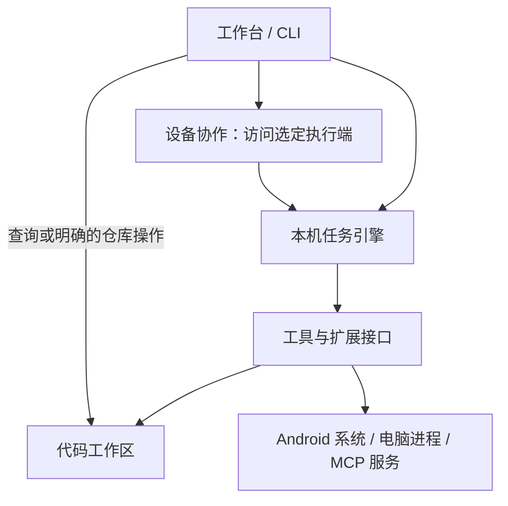
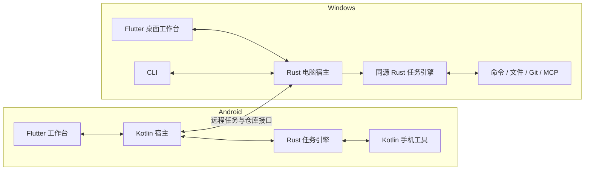

# Expert Chat：手机与电脑协同的 Agent 工作台

更新：2026-10-22。状态：**唯一主规划；电脑工作区与权限基础已开始实现，完整架构尚未完成。** 输入是用户已确认需求和源码检查；旧文档已归档，不作为本方案依据。

电脑任务机制的证据与复用选择见 [编码 Agent 调研](research/DESKTOP-AGENT-RUNTIME.md)，可评测的核心提示见 [提示词草案](prompts/DESKTOP-AGENT.md)。这两份文件细化本计划，不另立实施路线。

## 1. 产品定义

用户可以在手机上对话、处理资料、操作其他 App，也可以把代码或命令任务交给自己的电脑，在手机上查看执行过程、修改和 Git 历史。电脑提供可独立使用的 CLI。

目标交付包括 Android App、Windows 桌面工作台和电脑 Agent/CLI。按用户当前优先级，先贯通电脑工作区与现有会话，再按参考布局重构桌面工作台；Android 跨 App 能力继续保留在主规划中。Linux/macOS 电脑端与 iOS 列为后续范围。

界面围绕三个主要入口组织：**对话与任务、项目工作区、设备与配置**。MCP、钩子、Git 和终端出现在任务或项目的相关位置，不各做一个独立产品。

### 桌面布局方向

用户已提供桌面聊天应用截图作为重构后的布局参考。采用其信息层级与留白，不复制参考图中的私人会话内容。

- 最左侧为窄全局导航栏，放置主入口与设置；次级功能进入对应模块，不堆满常驻按钮。
- 左侧可折叠栏提供新建会话、搜索及“项目 → 会话”树。项目的文件工作区、资料和会话在同一项目入口关联，避免出现两套含义不明的项目列表。
- 主区域保留居中的“聊天／工作”切换。新会话显示简洁引导，已有会话显示消息与任务过程；正文限制阅读宽度，宽屏两侧保留空间。
- 输入框在新会话中处于视觉中心附近，开始对话后靠近内容底部。附件、工具与语音收进输入区的明确入口，不铺开整排开发按钮。
- 工作模式显示当前工作区，未选项目时使用默认工作区；工作区切换与权限入口跟随会话。文件树、差异、Git 图与运行记录按需在右侧展开，不在普通聊天中常驻。
- 窗口变窄时折叠导航或侧栏，保持输入和工作区切换可达；手机界面单独适配，不直接缩小桌面多栏。

第一版桌面布局已落地：窄导航栏、可折叠项目/会话侧栏、居中的聊天/工作切换、居中新会话输入区及会话底部输入区。思考与搜索选项收进输入框菜单，提供明暗主题和窄窗口适配。已有资料项目与代码工作区显示在同一区域，资料项目明确标注类型；两者的数据关联尚未统一。右侧文件树、差异和 Git 图仍为后续工作，当前保留原有大纲等业务面板。

第二轮界面调整：恢复用户原有主题配色；侧栏和搜索结果按聊天/工作分区。工作调用以常驻步骤和结果展示，工作目录以小字置于输入框下方，同一状态区提供上下文查看、缓存命中和费用。上下文快照及统计按会话记录本次打开软件以来的请求；快照保留最近一次请求，不写入历史库。缓存字段缺失不当作零命中，金额或币种缺失显示“未提供”，不套用其他服务价格估算。手机沿用居中模式切换、欢迎页、两行输入区和带底色的附件菜单，保留抽屉导航；Android Agent 能力仍按原计划建设。

### 必须覆盖的使用场景

| 场景 | 用户操作 | 可验收的结果 |
| --- | --- | --- |
| 接入模型 | 填写地址、密钥和模型，选择自动或指定协议 | 识别受支持的协议并正常流式对话；显示真实错误 |
| 电脑代码任务 | 选择仓库，描述修改，查看过程 | 独立 worktree 中修改、运行检查，返回文件差异和执行证据 |
| 工具扩展 | 配置 MCP 服务并选定任务可用工具 | 发现、调用工具，使用资源，查看结果与失败原因 |
| 执行钩子 | 为任务或项目设置检查、格式化和通知 | 在明确的事件点执行，失败行为可预期且可查看 |
| Git 工作区 | 打开项目的代码视图 | 文件状态树、分支/提交图、worktree 与任务关联可见 |
| 手机跨 App | 在 Android 发起观察、点击、输入、切换应用等任务 | 在真实设备上执行并回读结果，可随时停止 |
| 手机远程电脑 | 选择电脑，发起、查看、停止任务 | 手机离线不终止电脑任务；重连回到原任务 |
| 延续已有产品 | 使用会话、资料、学习、创作、语音和科研功能 | 分批迁入，正式替代旧版前明确每项覆盖情况 |

“类似编码 Agent”的效果需要模型能力、上下文组织、工具和结果核验共同达到。MCP、钩子和 Rust 本身不代表任务质量已经达标；用真实代码任务验证效果。

## 2. 五个模块及其责任

模块是职责边界，初期不要求分别建立包、进程或服务。

| 模块 | 负责什么 | 拥有什么 | 提供给其他模块 |
| --- | --- | --- | --- |
| **工作台** | 会话、任务展示、项目资料、学习、创作、语音及设置交互 | 业务内容、用户偏好和内容关联 | 提交任务、呈现事件、引用任务结果 |
| **任务引擎** | 模型接入、上下文与缓存策略、工具循环、有限子任务、预算、取消、状态、钩子触发时序 | 执行端的任务记录、步骤与结果清单 | 提交/查询/取消任务、订阅事件 |
| **工具与扩展** | 内置工具、MCP、系统动作和钩子执行 | 工具定义、连接配置、执行进程/句柄 | 能力清单、执行与取消、结构化结果 |
| **代码工作区** | 仓库、文件状态、差异、分支、worktree、提交历史 | 仓库与任务工作区绑定；Git 是仓库状态的事实来源 | 准备工作区、查询仓库、暂存/提交/合并等明确操作 |
| **设备协作** | 设备配对、能力查询、远程任务提交与事件续传 | 设备身份、连接配置和远程任务引用 | 访问指定设备上的任务及代码工作区 |

学习、创作和科研是工作台内的业务模块。各自管理业务规则，通过任务引擎使用模型与工具，不再把全部业务逻辑挂在聊天控制器上。

### 调用与依赖方向



这张图表达逻辑调用。手机访问电脑仓库时经过设备协作；不会让手机直接读取电脑数据库。任务引擎依赖工具接口，具体平台实现由执行端注册；核心不依赖 Flutter 或 Android UI。结果通过事件返回，执行器不反向调用页面或发起第二套模型循环。

工作台和任务引擎各自拥有的数据只由各自接口写入。任务引擎的手机实例与电脑实例各有存储；会话通过任务引用关联结果，不共享跨设备数据库文件。

## 3. 产品部署与技术选择

| 部分 | 本方案选择 | 原因与约束 |
| --- | --- | --- |
| 手机及桌面工作台 | Flutter / Dart | 当前已有两端界面与大量业务能力；按平台布局适配，按新模块迁入。Windows 工作台连接电脑宿主 |
| Android 系统能力与宿主 | Kotlin | 持有本机执行实例，接系统服务、权限、界面观察和操作 |
| 共用任务引擎 | Rust 库，优先验证 Rig 组件复用 | 电脑 CLI 与手机本机任务使用同一套任务、协议和工具循环；以两端原型与现成方案对照结果为门槛 |
| 电脑 Agent 与 CLI | Rust 程序 | 管理任务、进程、文件、Git、MCP 和远程连接；CLI 通过本机接口操作同一个宿主 |
| 文档处理 | 复用现有 Python 服务 | 作为可配置的 MCP 能力，普通聊天与代码任务不依赖它启动 |

React 不进入首期主链；现有 Web 原型保留为独立实验。当前选择是基于手机优先和现有资产的取舍，不是对其他技术的能力判断。

先验证成熟实现的复用范围：Rust 方案优先组合 Rig 与官方 Rust MCP SDK，电脑端以 OpenCode 的独立服务作对照。若整套复用的成本与质量更合适，再明确修订共享 Rust 引擎的选择；不为保留技术设想重复实现已有能力。Git、包缓存和编译缓存交给现成工具。候选能力、适配缺口与原型门槛见调研第 2 节；目前未安装或采用这些新依赖。



Flutter 与 Kotlin 使用平台通道，Kotlin 与 Rust 首先验证 UniFFI。Kotlin 持有本机核心实例，页面只提交任务和订阅事件。电脑宿主同时服务 CLI 与手机连接。以上是待验证的工程选择，机制依据见 [Flutter 平台通道](https://docs.flutter.dev/platform-integration/platform-channels) 和 [UniFFI 文档](https://mozilla.github.io/uniffi-rs/latest/)。

如果桥接、取消或生命周期验证不通过，先修订该选择，再开始业务迁移；不并行维护两个长期任务引擎。Android 进程被系统结束后保留中断记录，不能承诺无限后台执行。

## 4. 四项开发者能力如何落地

### MCP

电脑支持 stdio 与 HTTP 服务，手机支持 HTTP 服务；依赖电脑本地进程的 MCP 随电脑任务运行。首版覆盖能力发现、工具调用、资源读取、取消和错误显示；资源或工具是否可用按服务声明处理。[MCP 架构说明](https://modelcontextprotocol.io/docs/learn/architecture)。

配置展示服务所属设备、启动参数或地址、凭据引用与可用工具。用户级配置和项目配置覆盖关系明确；运行任务使用启动时选定的配置。协议适配根据实际服务协商，现有自定义文档服务兼容性单独验收，不把一个硬编码版本当作全部 MCP 服务。

内置工具与 MCP 工具进入同一任务循环。涉及文件的 MCP 必须能指向任务 worktree；客户端指定工作目录不会自动限制远程服务权限。

### 钩子

固定支持：**任务开始、工具执行前、工具执行后、任务验收前、任务结束**。配置只包含事件、筛选、动作/命令、超时和失败处理。执行前允许阻止动作，验收失败不能标记成功；结束通知失败记录为通知失败，不篡改已产生的任务结果。

电脑钩子在任务工作目录执行脚本；Android 通过宿主提供可支持的动作，不把桌面 shell 当作手机能力。项目附带脚本由用户启用后使用。钩子共享任务日志和取消入口，重连不重跑历史钩子，脚本引发的动作不递归触发同一钩子。

Git 的原生钩子仍由 Git 触发。应用显示其输出，失败时不自动绕过。无需为这些固定事件建立通用工作流语言。

### Worktree

代码修改任务默认从选定提交建立任务分支和 worktree；只读分析无需新建。任务绑定设备、仓库、worktree、分支和基准提交，命令、文件和钩子使用同一绑定。

同一 worktree 首期只允许一个活动写任务，多个修改任务使用独立 worktree。用户未提交改动不默认复制；若任务需要它们，明确选择要带入的改动。失败保留结果，清理不强制丢弃未提交或未保留的工作。worktree 隔离工作目录，同时共享部分 Git 数据，并不是进程沙箱。[Git worktree 文档](https://git-scm.com/docs/git-worktree)。

### Git 树

| 视图 | 内容与交互 |
| --- | --- |
| 文件状态树 | 文件目录、已修改/新增/删除/未跟踪、暂存/未暂存；查看差异、暂存和取消暂存 |
| 分支与提交图 | 提交父子关系、分支、标签、HEAD 与合并；查看历史和比较差异 |
| Worktree 列表 | 所在设备、路径、分支、关联任务、运行状态与未提交修改 |

电脑调用系统 Git 得到结构化状态，Flutter 绘制图形，CLI 展示相应文本信息。手机看电脑仓库无需先克隆一份。提交和合并是明确的仓库动作；任务完成不会自动触发推送。外部 Git 操作后可刷新，历史按需加载并标记不完整范围。

## 5. 手机操作与远程协作

本机任务使用 Android 工具观察界面、点击、输入、滚动和切换 App，再回读观察确认结果。首期在两个自有演示 App 上验证完整链路，再扩展实际应用。窗口缺乏可访问节点、受保护画面和权限撤销都需要明确结果，不宣称任意 App 都能操作。[Android 无障碍服务机制](https://developer.android.com/guide/topics/ui/accessibility/service)。

发行渠道与跨 App 使用方式在真机原型阶段评估，发布前依据渠道政策确定可交付范围；技术验证成功不等同于商店批准。

远程任务选择电脑后，由该电脑持有任务和配置，手机提供操作界面。第一版先在局域网或用户已有安全网络上连接，使用配对和受保护的连接；不在首期加入自建公网中继。手机配对不自动转移模型密钥或整个资料库。

同一提交标识对应同一任务；手机断连后查询原任务，按事件位置续传，不重复执行命令。取消以执行端确认状态为准；进程重启后如实标记中断，未确认的外部副作用先核验。首期每项任务固定一个执行设备，手机与电脑协作通过关联任务完成，不在任务中途自动迁移运行实例。

## 6. 模型接入与任务行为

首期兼容范围明确为 Chat Completions、Responses、Anthropic Messages、Gemini 原生四种协议。自动模式在已支持的适配器中选择与尝试，用户可以手动固定；不承诺自动理解任意未知私有协议。

只在明确的协议不兼容且尚未输出时尝试其他协议；鉴权失败、限流、超时或已产生部分结果不触发跨协议重发。开始工具往返后保持协议一致。任务的工具能力、预算、执行设备和工作目录在开始时确定。

任务引擎负责“模型提出动作 → 执行 → 回读结果 → 继续或结束”。错误保留原因，重试只由一个明确责任方决定，避免各层重复兜底。共享状态记录和有序事件即可满足首期需求。

### 电脑开发任务的运行约定

- 核心提示和基础工具定义保持版本稳定，运行信息与工具结果追加在后部；缓存参数按供应商、模型和 API 能力适配。观测缓存读/写和总成本，不以命中率单独判断优化成功。
- 保存完整事件与日志，模型按需获取文件与相关输出。先限制长工具输出，再在预算需要时减少旧观察和压缩任务状态；保留目标、约束、改动、验证与运行中任务。
- 单代理作为基线；独立检索、审查和实现才派遣子代理。首个原型限制并发与派遣深度，精简交接，写入任务使用独立 worktree，主代理整合后验证。
- 保留每任务的工作区和增量构建状态，共享包下载及经验证的编译缓存。钩子改动后的测试证据必须对应最终代码；不默认 clean 或重复安装依赖。
- 所有机制采用统一工程任务对照有效完成率、端到端时间和全体调用费用，详见调研第 10 节。

## 7. 目标目录与迁入方式

以下目录表示目标模块归属。当前已创建 `next/desktop` 与 `next/verification`，其他部分仍为规划。新实现先在 `next/` 验证，原应用继续维护；验收切换后再决定是否提升为根目录布局。

```text
next/
├── app/                         # Flutter 工作台
│   ├── lib/workspaces/          # 对话、项目、代码视图、学习、创作、科研
│   ├── lib/task_client/         # 向本机宿主提交任务、订阅事件
│   └── android/                 # Kotlin 宿主与系统工具
├── engine/                      # 一个共享 Rust crate
│   └── src/                     # 任务、模型、上下文、工具接口、钩子时序、任务存储
├── desktop/                     # 一个 Rust 宿主 crate，含 CLI 与服务入口
│   └── src/                     # 本机工具、MCP 进程、仓库/worktree、远程连接
└── verification/                # 人工协议样例、设备场景、迁移样本
```

工具接口在核心，Android 实现在 Kotlin 宿主，电脑实现在 desktop；可复用的 HTTP MCP 适配可放核心内部。代码工作区的 Git 执行只在电脑，图形视图在工作台。这里的目录不意味着把每个模块再拆为独立 crate。

现有 Python 文档服务保持原路径，通过 MCP 接入。现有 React 实验工程、Gateway/AuthService 不默认成为新主链依赖；正式替代旧版本前核对实际使用范围并决定保留方式。

### 当前资产的处理

| 当前来源 | 重构决定 |
| --- | --- |
| `lib/features` 的业务页面 | 按用户工作区复用或调整，接新任务客户端 |
| `lib/state/chat_controller.dart` 及其分部 | 执行逻辑迁入引擎，业务状态回归各自工作区，不整体复制控制器 |
| `lib/domain/llm`、`lib/domain/mcp` | 作为行为和兼容场景参考；Rust 实现用同一组独立样例核对 |
| `lib/domain/study`、`story`、`memory` 与 `lib/data` | 保留有效业务规则，按所属业务迁入；数据转换单独验证 |
| Android 原生分享、通知等 | 可复用的适配接入新宿主；跨 App 执行器新增 |
| SSH/SFTP/tmux | 保留科研交互能力；与电脑 Agent 的自主任务分别提供入口 |
| 现有测试 | 用作行为证据和回归场景，不把旧测试数量当作新工程已通过 |

## 8. 实施顺序与完成条件

不按目录依次搬文件，按用户能完成的任务交付。各阶段的任务/数据接口在同一主规划下调整。

| 阶段 | 交付内容 | 进入下一阶段的条件 |
| --- | --- | --- |
| **1. 两端最小贯通** | 验证现成组件复用；Android 工作台、Kotlin 宿主、Rust 候选核心、Windows 入口；一个协议、一次工具调用与用量记录 | 两端流式、工具、取消与生命周期正确；完成 OpenCode 电脑对照，选定复用路线与桥接 |
| **2. 电脑开发任务** | CLI、文件/命令、MCP、固定钩子、worktree、Git 查询；编码提示、上下文/缓存与有限子代理 | 修改与测试闭环；工作区不互相覆盖；钩子与 MCP 正确；单代理/子代理、上下文和缓存对照有证据 |
| **3. 手机远程工作区** | 配对、远程任务、事件续传、文件树、提交图、worktree 列表与基本 Git 操作 | 手机发起任务，离线五分钟后恢复同一结果；图形与真实 Git 状态一致；能查看差异、暂存、提交；取消状态真实 |
| **4. Android 跨 App** | 观察、动作、回读、停止、权限生命周期 | 两个演示 App 上三条完整任务可重复完成；权限撤销/界面变化可解释；停止后不再派发新动作；确定发行范围 |
| **5. 产品迁入与切换** | 四协议、会话/资料/语音/学习/创作/科研、配置和备份导入、安装包 | 功能覆盖逐项核对；旧数据导入副本并可回退；Android + Windows 完整场景通过后切换 |

阶段 1 同时做最小 Android 观察/动作可行性试验，尽早发现系统能力或发行问题；阶段 4 才建设完整产品体验。阶段 3、4 在接口稳定后可独立推进，不要求先建设分布式调度平台。

阶段 5 按“会话与配置 → 项目/资料/记忆 → 语音 → 学习/创作 → 科研”迁入。每个工作区均保留样本输入、预期输出、迁移结果和失败恢复证据。未迁入功能明确标注，不静默删除。

数据导入写新版本副本，保留原库、文件与关联用于核对。API 密钥交给各设备安全存储；业务数据库不与任务引擎抢写同一实体。新版本通过前不修改现用库结构。

## 9. 控制复杂度

首期采用单机宿主、直接接口、普通任务状态与事件记录。先解决实际错误处理、取消、工作区归属与结果核验。暂不建设插件市场、自定义工作流语言、多 Agent 调度平台、云端账户体系、全量跨设备同步或消息队列集群。

有限子代理是现有任务引擎内的父子任务关系，不单独建立调度平台。原型先限制为主代理加最多两个子代理、派遣一层，再根据真实任务证据调整。成熟组件先验证后复用，仅补足本项目的设备、工作区和业务边界。

每新增一个包、服务或抽象，先指出它解决的已出现问题；仅有“未来可能需要”不足以拆分。模块验收关注用户能否完成任务，不以目录数量、语言数量或重写代码量衡量。

## 10. 当前完成范围

已归档原文档，完成模块规划、运行机制调研与 HTML 框图。按用户要求，先实现电脑执行端的工作区和权限基础，入口见 [电脑工作区 CLI](../next/desktop/README.md)。

已实现：注册/查看/移除工作区，目录级只读/读写/拒绝与额外目录授权，运行时检查和即时撤销，带版本检查的文件修改，以及绑定单个工作区的 stdio MCP 服务。Windows 界面已加入“工具 → 电脑工作区”，通过本地 CLI 共用执行端配置，构建时自动打包执行端。现有 Flutter 工作循环已接入本机命令和 SSH 工作区，以及请求批准、模型辅助批准、完全访问三档策略。命令以系统或 SSH 账号权限执行，工作目录不是进程沙箱；本机含只读/拒绝规则时不开放任意命令。

会话“工作”模式已接入该文件服务：未选项目时自动使用应用专用默认工作区，可按会话切换已登记项目；模型工具调用和结果回送复用现有会话执行循环。绑定只存本机，任务执行中固定目标，权限仍由 Rust 实时检查。

桌面外壳已按参考布局重构。全局导航、项目/会话导航和当前会话分层展示；从代码项目新建会话自动绑定工作区，全局新会话回到聊天模式，之后开启工作模式即使用默认工作区。侧栏折叠和页面切换保留当前会话及草稿，手机继续使用原有抽屉入口。

这不表示阶段 1 或阶段 2 已全部通过。共享 Rust 模型引擎尚未实现；后续验证命令隔离后端及 Agent 组件复用，再接入自主构建/测试和手机界面。没有迁移旧业务目录或用户数据库。

## 11. 工作台补齐计划与本轮分工

按用户要求分派三个子代理并行实施，主代理负责现有工作循环、权限与页面入口的接线。沿用当前 Flutter/Dart 执行链，不在这一轮同时迁移语言或数据库。

| 批次 | 模块与交付 | 责任划分 | 完成条件 |
| --- | --- | --- | --- |
| **本轮首批** | 文件改动清单、逐行 diff、版本校验撤销 | change_review 子代理；主代理接文件工具记录 | 本机/SSH 文件工具写入后可查看改动；撤销仍检查原目标与版本 |
| **本轮首批** | 任务状态、实时 stdout/stderr、停止入口与最小执行记录 | task_runtime 子代理；主代理接审批与命令流 | 可识别执行中/等待批准/结束；重启未完成任务标为中断 |
| **本轮首批** | 文件树、文本预览、Git 状态/diff/分支/提交父子关系、worktree 列表及创建 | git_workspace 子代理；主代理核验工作区授权 | 用户在统一工作台浏览；创建前明确展示分支和目标路径 |
| **下一批** | 固定工具前后钩子、应用内有限子代理、多模型选择、worktree 任务绑定 | 在上述执行事件与工作区接口上扩展 | 主代理可派遣最多两个独立子任务、回收结果；写入任务各用独立工作树，不自动合并/推送 |
| **后续** | 后台进程与持久化任务队列、断线查询和事件续传 | 执行端负责任务，界面订阅状态 | 退出界面不等于任务消失；重启后可区分可恢复与需人工核验的任务 |
| **最后接入** | 手机远程工作台与 Android 本机动作 | 复用任务/工作区接口，Android 宿主执行设备动作 | 手机查看真实文件改动、日志、审批与任务状态 |

首批范围：快照跟踪文件工具的文本写入，不覆盖任意命令的全部文件副作用。已存在文件可按最新 hash 撤销；新增文件暂不提供删除式撤销。Git 视图和 worktree 创建先支持本机；SSH 提供文件浏览、写入与实时命令日志。worktree 创建不自动注册授权、不自动提交、合并或推送。执行记录持久化，实时日志仅保留本次运行的有界尾部；不宣称已经实现进程跨重启续跑。

本轮按用户要求不追加测试套件或全量验证；子代理提交模块后，由主代理完成必要代码整合与 Windows 编译，修正编译阻断后打开软件。

## 12. 2026-10-23 用户追加需求与实施批次

本节记录之后的明确要求，覆盖上文早期原型限制。用户此前要求只记录；现已授权派多个代理开始实施。保留当前 Flutter/Dart 主链和已有用户数据，不同时做执行引擎重写。当前一次集成只交付可核验的第一批，其余事项保留为待办，不能把设计或配置入口称为功能完成。

### 第一批：代码已集成，Windows Release 构建通过

- 运行可靠性：区分等待后台结果、完成、失败和停止；完成/停止后迟到事件不能启动新任务。错误提示可关闭，不改变真实任务结果；网络错误根因需按实际请求诊断，不能靠隐藏卡片宣称修复网络。
- 并发：每个工作任务内部按配置限制子代理并发，独立工作会话不共用全局任务数量上限。保留深度和直属子代理数量限制。
- 界面：普通聊天不显示工作目录、执行位置与工作权限；长模型名可读；项目/MCP/模型弹层具有内部留白、视口边距和有界滚动；状态栏主题自适应；长执行记录方便折叠。
- 会话侧栏：工作视图可筛选“正在进行”，程序按最近执行活动排序并节流；不是人工拖动。运行中显示动态标识，完成绿点、待人确认橙点、错误红点。
- 最终交付：文件变更与最终交付清单分离；只有主代理明确登记、实际读到的最终成果进入交付区。保存版本标识，后续修改使旧登记失效；不把全部写入、日志和调试产物自动当成交付。
- 默认指令：提供直接可用的主代理和各子代理角色指令，设置页展示默认内容、允许修改与恢复；不覆盖已保存的用户指令。权限、停止和容量由代码执行，不交给提示词兜底。
- 浏览器：基于官方 Playwright 能力提供可选接入、依赖提示、按会话隔离的模型操作和生命周期管理。页面导航、读取、点击、输入、截图及控制台/网络诊断依赖实际发现的工具；外部受控浏览器与嵌入 WebView 的关联程度必须如实说明。

### 第二批：上下文、工具与质量基础（待实施）

- 调研论文与原始实现，再设计主动压缩、关键约束保留、版本化检查点、历史检索/恢复，以及主子代理上下文交接。当前本地摘录不等于完整工作记忆。
- 记录少量任务关键规则，针对修改后状态失效、独立数据身份冲突、损坏恢复等跨操作情形做检查。验收证据绑定最终产物版本，不以测试数量或子代理“已完成”声明代替证据。
- 工具管理：发现、按需加载、安装/更新、依赖诊断与权限管理；数学工具包括精确计算、符号/数值计算、统计、绘图及结论验证。
- 检查点与恢复：保护用户编辑的按轮回退、逐文件/逐块审阅，恢复已完成与未确认操作时避免重复副作用；程序重启后的任务续接必须有执行记录支持。
- 浏览器与工作台贯通：展示受控页面和操作状态、用户接手、选中页面元素反馈、截图/日志回传；不能以独立 MCP 窗口冒充内嵌浏览器联动。
- 任务计划、运行中补充要求、待生效设置和暂停/停止具有明确状态；文件/终端/浏览器/变更始终归属正确会话。多代理共享项目增加职责划分、冲突检测与适用时的独立工作树。

### 第三批：模型服务、监督与角色积累（待实施）

- 参考 https://github.com/yetone/magpie 的模型、渠道、账号、路由分层。以模型为主要入口，Base URL/密钥或订阅登录后扫描模型；同模型多渠道优先级可拖动，独立管理 Auto/备用模型策略、额度、故障恢复与路由记录。订阅能力逐项验证，不从参考项目宣传推定已可用。
- 可选监督模型：观察目标、公开计划、工具事件与产物，按能力缺口、重复失败和关键交付触发。工具建议由程序鉴权、当前工具轮结束后生效；建议绑定执行版本以丢弃过时意见，不依赖完整思维链。比较有无监督的质量、延迟、成本与无效干预。
- 角色积累：找不到合适角色时先检索现有角色和资料，再创建待验证角色，试用与验收后进入可复用库。保存来源、范围、验证结果和版本；用户能修改/禁用/删除/回退，自动更新不覆盖用户改写。继续遵守模型池、权限、并发和递归限制。

### 后续基础能力（待实施，不以后台托盘替代）

- 执行端独立于界面的持久化任务、远程连接与断线续传、可复用项目环境。
- 定时/文件/仓库/外部事件自动化，明确触发原因、去重、暂停和运行历史。
- 综合工具与插件管理，以及最终成果的多文件项目组织和必要依赖打包。

第一批由 runtime_reliability、ui_polish、browser_capability 三个子代理并行，主代理负责交付清单、默认指令、集成审查和定向检查。不得重置已有未提交修改，也不得为更新程序中断正在进行的用户任务。

#### 第一批检查结果与边界

- 已通过针对任务续跑/停止/关闭错误竞态、独立任务并发、浏览器会话隔离、交付清单版本与恢复、默认指令编辑和界面布局的定向检查。发现并修复 shell 在 LayoutBuilder 布局阶段移动 GlobalKey 子树导致的 Tooltip/OverlayPortal 缩放断言。
- 使用实际 Dart MCP 客户端和官方 Playwright MCP 0.0.83，在隔离的无头 Edge 中验证本地页面导航、输入、点击、截图、控制台、网络和双会话状态隔离；没有接管用户已登录的浏览器。
- Playwright 为可选 MCP 预设，需要 Node.js 与对应浏览器。当前使用独立浏览器，尚未联动工作台 WebView；子代理可读页面快照，子代理自身的截图视觉回传仍待完善。
- 交付登记复用权限检查后的文件读取，支持当前文件服务上限内的二进制（8 MiB）；二进制及过大文本不伪造增删行。登记后本轮再次执行任意 shell 命令会保守撤回交付选择，需重新登记；不是对外部进程任意改动的实时文件监控。
- “正在进行”的活动排序每 5 秒最多更新一次，完成项保留在当前侧栏实例内；排序历史尚未持久化。
- 连接错误卡片可关闭且不改变执行结论；没有以关闭卡片替代用户所报真实网络故障的诊断。部分旧 UI 测试仍使用此前已删除控件的断言，未宣称全量测试通过。

### 后续修复：首次响应等待与运行日志

根据用户实际失败记录：一次工具后续请求在 30 秒响应头等待处超时，另一次只保存了泛化的“网络连接中断”，无法还原底层原因。已增加以下实现：

- 工作主代理和子代理的模型响应头等待默认 120 秒，设置 → 能力 → 模型响应等待可在 30–600 秒调整。使用原有任务预算 JSON 保存，旧设置缺省自动采用 120 秒。主任务在完整工具轮边界应用新设置；普通聊天保持协议适配器默认值。
- OpenAI Chat、Responses、Anthropic Messages 和 Gemini Native 四种协议均读取客户端请求级超时；该设置不进入上游请求正文，固定渠道也不会固定旧的等待时间。连接建立、流式空闲和任务总预算仍分别计算。
- 超时错误保留“等待响应头／流式空闲”与等待上限；连接错误保留 Dio 类型、服务主机、底层异常类型和可用的系统错误码。未知非传输异常不再一律称为网络中断，不记录任意异常的请求/响应正文。
- 新增工作台“日志”页与运行中入口。按会话显示主/子代理请求、首个响应、工具、进程和状态事件，支持全部/错误筛选、展开诊断、复制和导出 JSONL。用户上翻阅读时暂停自动跟随。
- 本地日志保留 7 天，每会话 200 条、全局 1500 条且总数据约 1 MiB 内；错误即时排队保存，其余事件合并保存。敏感值脱敏，不保存提示词、工具参数、文件正文或响应正文；日志损坏/保存失败不阻断执行。旧错误不能事后补录原始信息。
- 已通过四协议慢响应测试、超时设置继承/持久化/轮次边界测试、错误分类与脱敏、日志保留与恢复、窄屏筛选与滚动检查。没有对用户付费模型发送重放请求。
- 命令执行详情改为命令、退出状态、输出的分区展示，解码 JSON 中的命令字符串，使用等宽字体保留对齐；支持复制、换行/横向滚动，其他参数折叠。只按已知输出格式分离 stderr，不臆造退出码或错误流。
- 新建本机交互终端默认优先 PowerShell 7（含 Windows Store 执行别名），没有 pwsh 时退回 Windows PowerShell；保留 Shell 自身的补全、历史和 profile。已用真实 ConPTY 验证本机 PowerShell 7 输入与 Tab 补全。已有终端及模型命令执行器不被热切换，SSH 沿用远端 Shell。
- 用户正在执行任务时，不重启旧程序。此轮 Windows 包构建至 `output/releases/timeout-logs`；完成后恢复常规 CMake 输出配置，避免改写正在运行的 Release 包。

### 2026-10-24 追加：思考显示翻译

用户随后明确要求实施。翻译作为 UI 显示层：从服务商已返回的原始思考段落读取文字，独立请求所选翻译模型，不改写 ChatMessage.reasoning、主/子代理请求历史或工具事件的原始偏移。

- 展开思考/执行记录后，可选择已配置模型或跟随当前会话，显式点击翻译；支持原文、中文、对照，窄屏上下对照，宽屏并排。
- 运行中按稳定片段增量翻译；缓存键包含源文本哈希、模型/提供商和翻译提示版本，已完成片段复用。未译尾部标明原文，停止翻译不停止工作，界面刷新不自动恢复已停止的翻译。
- 公式和代码通过保护片段原样恢复；不完整响应、模型请求工具或占位符缺失视为翻译失败，保留原文且不缓存失败输出。选择新模型时不把旧模型译文当成新译文展示。
- 译文侧缓存有容量/时间限制，与消息及上下文分开；删除会话取消相关翻译并清理派生缓存。翻译额外用量独立展示并计入辅助用量，缺失统计不伪装成零。运行日志记录翻译请求的阶段与脱敏诊断，不记录原文/译文正文。
- 用户现有任务运行期间继续使用独立 Windows 交付目录 `output/releases/thinking-translation`，不覆盖或关闭运行中的旧版本。
- 实施检查完成：翻译后端 5 项、相关界面 10 项定向测试通过，Windows Release 暂存构建成功，常规 CMake 输出路径已恢复。检查使用模拟翻译模型，没有向用户的付费服务提交测试翻译请求。

后续终端配色修正：PSReadLine 默认发送 ANSI 37/93/92 等明确颜色，单独把终端背景改成浅色会导致白字和亮黄色输入难以辨认。工作台及科研终端共享的调色板现按主题明暗选择；浅色使用深色语义高亮，深色保留亮色，搜索选区随主题调整。没有修改 PowerShell profile。已检查实际 PSReadLine 颜色码、输入颜色对比度和明暗预览。
