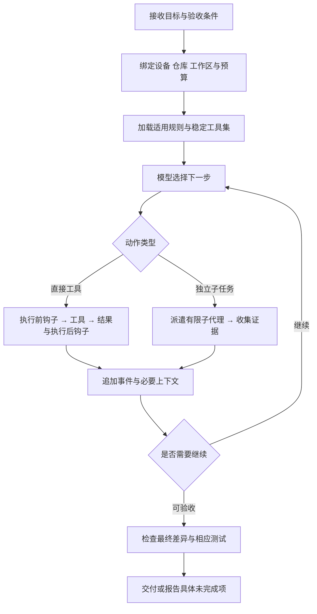

# 电脑编码 Agent 的运行机制与复用方案

调研日期：2026-10-22。适用范围：Expert Chat 的电脑开发任务，以及未来手机共用任务引擎。本文是 [主规划](../PROJECT-PLAN.md) 的设计依据；实现与性能结果须由原型验证。

近期论文与作者实现的补充核验见 [缓存研究更新](CACHE-RESEARCH-2026-10.md)，涵盖 9–10 月的新工作。其应用层比较实验纳入本文第 10 节；服务端 KV 改造不成为当前客户端前置依赖。

建议采用已有 Agent 的简单工具循环，优先复用模型库、官方 MCP SDK、系统 Git 和构建工具缓存。在这一基础上补充本项目需要的工作区绑定、跨设备任务状态和有限子代理管理。优化目标是**同等任务质量下，降低完成时间和总成本**，缓存命中率是诊断指标之一。

## 1. 现有代码的具体问题

以下是源码检查结果；风险影响需要实际请求和任务记录验证，不能据此宣称某个命中率或完成率。

| 观察与证据 | 对电脑开发任务的影响 | 建议 |
| --- | --- | --- |
| [请求构建器](../../lib/domain/chat/request_context_builder.dart) 将项目资料插到最前，工具、图像、记忆等提示也进入前置 system 消息 | 项目资料或工具提示变化可能使较早位置的前缀改变；资料与行为指令混在一起 | 稳定规则、项目约定、运行信息和检索资料分开组织 |
| [工具提示](../../lib/domain/chat/client_tool_prompt.dart) 以日期开头；[日期函数](../../lib/domain/tools/tool_engine.dart) 每天变化 | 跨天变化可能影响该位置之后的缓存；并非每次请求都产生不同时间戳 | 日期只在需要时作为运行信息提供，不放全局固定提示开头 |
| [工具列表构造](../../lib/state/chat/generation.dart) 随附件、模式和强制工具变化 | 每轮改变 tools 可能影响缓存；MCP 工具集需要稳定的顺序与版本 | 一个任务使用确定的基础工具集，额外能力按明确机制加载 |
| [上下文管理器](../../lib/domain/context/context_window_manager.dart) 合并前置 system 内容，超过输入预算的 45% 时从中间裁剪 | 工程约束、用户偏好、资料可能被一起剪掉，缺少按语义保留的机制 | 核心规则不做字符裁剪；先缩减可重取的资料与日志 |
| [上下文默认配置](../../lib/data/context_prefs.dart) 最多保留 24 条非 system 消息；摘要最多约 700 tokens，工具文本取前 80 字符等 | 多次工具调用可能很快触发截断，首行摘录不能稳定保存改动、失败原因和待办 | 以任务状态与完整工具交互为单位管理，替换固定消息数量限制 |
| 当前 token 估算主要针对 messages，用 ASCII 字符近似和固定图片估算 | 单独提供的工具 schema 等没有进入该估算入口；不同模型的误差不同 | 在最终协议请求层计入工具、图像和输出/推理预算，并记录估算误差 |
| [usage 解析](../../lib/domain/llm/llm_provider.dart) 的 Chat Completions 路径读取 `prompt_tokens_details.cached_tokens`，未读取 DeepSeek 的 `prompt_cache_hit_tokens` | 某些后端实际命中也可能在应用内显示为零 | 按供应商/API 解析，缺少字段显示“未报告”而不是零 |
| [Anthropic 适配](../../lib/domain/llm/anthropic_messages_provider.dart) 已统计 cache read，并将 cache creation 计入输入，但请求未声明 `cache_control`；统一 usage 没有独立 cache write 字段 | 原生客户端没有明确的缓存写入策略，成本统计不够细 | 补充缓存能力配置和读/写/普通输入的独立统计；网关额外行为单独核实 |
| [模型用量存储](../../lib/domain/llm/model_usage_store.dart) 有累计命中率；[用量装饰器](../../lib/domain/llm/usage_tracking_llm_provider.dart) 记录终态 usage | 已有观测基础，但缺少任务、请求、压缩前后与子代理维度 | 扩展现有统计语义，不新建平行计费体系 |
| [Android 构建配置](../../android/gradle.properties) 关闭 daemon、并行和 Kotlin 增量编译；增量关闭注释提及跨盘路径问题 | 当前配置偏向已知环境的稳定运行，不适合直接推断未来缓存表现 | 建立同盘、跨盘和并行 worktree 对照，按结果调整 |

已有优点也应保留：工具调用与返回按协议单元处理，原生推理/签名字段尽量保持完整，预算在工具轮次之间累计，自动协议尝试受限。这些比单纯增加提示词更重要。

当前通用工作模式提示强调执行和核验，但还不能作为完整编码 Agent 的提示：缺少明确工作区、修改与验证流程、长任务状态、子任务交接规则。没有真实编码任务评测前，不能判断它“已经足够好”。

## 2. 复用什么以及如何选择

| 现有项目或机制 | 已确认的能力 | 本项目的处理 |
| --- | --- | --- |
| mini-swe-agent | 将 Agent、模型和执行环境分开；核心循环负责请求、执行、记录与预算 | 作为最小行为和评测基线，避免先搭复杂调度框架；Python 实现不直接当作 Android Rust 核心 |
| Rig | Rust 模型接口、工具与多轮流式、钩子，以及上下文/运行记录等组件 | 共享 Rust 核心的首选验证候选；先检查真实协议字段、取消和 Android 目标，不按功能清单直接判定可用 |
| OpenCode | 可独立运行的 HTTP 服务、OpenAPI、会话与事件接口、主代理和子代理 | 电脑端整套复用的对照方案。若现成服务满足目标，手机可以接它；这条路线意味着重新评估“两个执行端共用同一 Rust 引擎” |
| 官方 Rust MCP SDK | Rust 的 MCP 客户端/服务端协议与传输实现 | 优先采用并锁定版本；现有文档 MCP 的兼容差异放在薄适配层 |
| Git CLI、Cargo、Gradle、sccache | 仓库操作、增量构建、任务输出与编译缓存 | 直接调用；应用组织任务、记录结果，不自写 Git 或编译缓存引擎 |

依据：[mini-swe-agent 源码](https://github.com/SWE-agent/mini-swe-agent/blob/main/src/minisweagent/agents/default.py)、[Rig 官方仓库](https://github.com/0xPlaygrounds/rig)、[OpenCode Server](https://opencode.ai/docs/server/)、[OpenCode Agents](https://opencode.ai/docs/agents/)、[Rust MCP SDK](https://github.com/modelcontextprotocol/rust-sdk)。这些项目的实现会继续变化，开始原型时记录所用版本和提交。

**先验证复用，再补缺口。** 原型比较两条路径：Rig 组件构成共享核心，与 OpenCode 整套电脑服务。比较统一场景中的完成质量、流式/取消、MCP、任务恢复、工具调用与签名完整性，以及维护成本。无需为了比较预先建设两套正式产品。正式实现选定一条主路线，保留测试证据；没有使用中的需求，不做通用多引擎插件层。

本项目确实需要自己定义的是：移动工作台到执行端的任务契约、Android 工具桥接、任务与 worktree 的关联，以及旧业务/数据迁移。上述候选库尚不能自动证明这些部分已经满足要求。

## 3. 从论文与成熟实现中采纳的设计

| 来源 | 研究或实现结论 | 本项目采用方式与限制 |
| --- | --- | --- |
| SWE-agent 的 ACI 研究 | 工具接口、编辑反馈和检索结果呈现会影响编码表现 | 优先把文件读取、搜索、编辑反馈与命令输出做清楚；不把 2024 年模型实验的具体参数视为今天的通用最优值 |
| The Complexity Trap | 在该论文的 SWE-agent / SWE-bench Verified 实验中，简单遮蔽旧观察可与 LLM 摘要竞争成本和解题效果 | 把“减少旧工具输出”列为基线；同时计入现代缓存重建成本，不能直接照搬论文的节省比例 |
| MAST 多代理失败研究 | 失败涉及任务定义、代理间协调以及验证/结束条件 | 子代理必须有范围、产物和验收；主代理整合后验证，不能把多份“完成”声明当作正确性 |
| Claude Code 缓存经验 | 提示内容布局、工具变化和运行信息更新都会影响前缀复用 | 固定稳定部分，新增状态放后部；压缩与模型切换单独评估 |

论文与原始实现：[SWE-agent](https://arxiv.org/html/2405.15793v3)、[The Complexity Trap](https://arxiv.org/html/2508.21433v1)、[MAST](https://arxiv.org/html/2503.13657v2)、[Claude Code 缓存设计](https://claude.dev/blog/lessons-from-building-claude-code-prompt-caching-is-everything/)。这里只采纳与问题相关的机制，不比较不同年份、模型和测试条件的排行榜分数。

## 4. 电脑任务的完整执行流程



循环复用已有实现，宿主处理进程、工作区和连接。任务不预先强制经过“规划者→程序员→审查者”的固定多代理流水线；简单修改可以由一个代理直接完成。

独立读取和搜索可批量并行。修改后测试、依赖其他结果的操作和共享工作区写入按依赖执行。长命令返回句柄，后续读取增量输出、等待或取消；不反复重新启动命令查询进度。工具返回执行状态、退出码、摘要和完整日志引用，不能仅返回“执行成功”一句话。

格式化钩子可能改代码：测试证据必须关联测试时的工作区状态；测试后钩子又产生相关修改时，需要重新验证受影响部分。命令、钩子和子代理使用同一父任务的预算与取消范围。

## 5. 模型缓存如何尽量命中

### 5.1 先区分四类缓存

| 类型 | 保存内容 | 能解决什么 |
| --- | --- | --- |
| 模型前缀缓存 | 服务端已处理的输入前缀状态 | 减少重复输入处理的成本与延迟，不是保存答案 |
| 依赖下载缓存 | 已下载的包、索引与工具链 | 减少联网和重复下载，不代表编译或测试通过 |
| 编译/任务输出缓存 | 构建系统判定输入相同的输出 | 减少重复编译或任务执行 |
| 任务检索缓存 | 已读取文件与索引结果及其内容版本 | 避免重复读取；文件变化后必须失效 |

四类命中率分别记录。模型“记得读过文件”不等于磁盘内容仍未变化，编译缓存命中也不等于新修改已经验证。

### 5.2 稳定前缀与追加式上下文

本项目采用以下逻辑分层，实际 wire 顺序由供应商适配器决定，不能假定所有 API 都按应用消息数组渲染：

```text
固定核心规则和稳定基础工具定义
  → 适用的项目规则与任务内固定配置
    → 任务目标和初始环境信息
      → 追加的用户指令、工具结果、文件变化与阶段状态
```

具体实现原则：

- 核心提示按版本固定，不嵌入当前时间、随机 ID、实时 Git 状态或余额。动态信息按需要追加。
- 工具名称、schema、说明和顺序确定；MCP 列表使用稳定标识排序，排除发现顺序导致的变化。
- 已写入的历史消息尽量保持原样，新信息追加为新消息；不要每轮重新润色旧总结或把最新工作状态插到最前。
- 项目规则读取成带版本的快照；真实规则或用户需求改变时及时更新，即使需要失去部分缓存，也不保留过期指令。
- 不向每轮塞入全部 MCP schema。优先使用所选供应商/库成熟的工具发现机制；无此能力时任务开始时选定小工具集，真实新增能力允许付出缓存代价。
- 关闭某个动作的执行权限由宿主落实；保持 schema 稳定不等于放宽权限。不能仅用一句“现在不能写”代替实际执行约束。
- 模型、API 协议与影响前缀的设置在一个任务阶段内保持稳定；用户主动更改时明确建立新上下文，不静默跨模型转移不兼容的签名或隐藏状态。

这组选择借鉴 [Claude Code 的缓存布局](https://claude.dev/blog/lessons-from-building-claude-code-prompt-caching-is-everything/) 与 [OpenAI 缓存诊断](https://developers.openai.com/api/docs/guides/prompt-caching/diagnostics)。项目内应记录各层摘要哈希及前缀首次变化位置，默认不记录密钥或完整私人提示内容。

### 5.3 供应商不能共用一个缓存开关

| 服务 | 调研时确认的区别 | 适配要求 |
| --- | --- | --- |
| OpenAI | 当前文档区分模型代际；新模型有显式断点、缓存写入和新的 TTL 配置，旧模型的 key/retention 规则不能通用 | 按模型/API 能力生成缓存参数；读取 cache read/write，不能只看 `cached_tokens` |
| Anthropic | 通过请求级自动缓存或内容块 `cache_control` 设置断点；tools/system/messages 的变化影响不同范围 | 优先在稳定部分和可复用边界设置缓存；读、写和普通输入分别统计 |
| Gemini | 隐式与显式缓存的可用范围取决于模型和 API；当前 Interactions 不支持显式缓存 | 不把 generateContent 的参数发送给所有 Gemini 接口；按实际 API 解析 usage |
| DeepSeek | 自动缓存仍要求匹配已持久化的前缀单元，按 best effort 工作 | 保持可复用前缀，读取其原生 hit/miss 字段；不承诺第二次请求一定命中 |

依据：[OpenAI Prompt caching](https://developers.openai.com/api/docs/guides/prompt-caching)、[Anthropic Prompt caching](https://platform.claude.com/docs/en/build-with-claude/prompt-caching)、[Gemini Context caching](https://ai.google.dev/gemini-api/docs/caching)、[DeepSeek Context caching](https://api-docs.deepseek.com/guides/kv_cache/)。能力应由所用端点、模型和版本决定；“兼容 OpenAI 协议”的第三方地址不自动继承 OpenAI 的缓存语义。

缓存 key 如需使用，应稳定且按凭据主体/项目策略区分，不含原始密钥，也不每轮随机生成。key 不是命中保证。不要为了达到缓存阈值灌入无用文本，也不要为了续期发送无任务价值的请求。

### 5.4 成本与指标

统一记录：模型/API、任务与子任务 ID、普通输入、缓存读取、缓存写入、输出/推理、首字延迟、总时长、重试以及压缩成本。服务端未报告的字段保留“未知”。不同供应商的 input 总量定义先归一化，防止把已经包含的 cache read/write 再加一次。

```text
输入 token 命中率 = 缓存读取 token / 归一化后的全部输入 token
任务总成本 = 普通输入 + 缓存读取 + 缓存写入 + 输出 + 缓存存储费用
           + 摘要与子代理调用 + 失败重试的实际费用
```

上式各项指按对应单价计算的费用；写入分档等字段不能与其总计重复累加。主指标为有效完成率、每次有效完成的成本和端到端时间，辅助指标为命中率、缓存写入占比和前缀变化原因。压缩后命中率下降但总成本减少，也可能是正确优化。

## 6. 系统提示词与工具说明

使用简短、版本化的编码任务核心提示，见 [提示词草案](../prompts/DESKTOP-AGENT.md)。按实际能力加载工具说明和项目规则；不要每轮把聊天、写作、绘图与电脑开发说明全部拼在一起。

| 内容 | 应放的位置 |
| --- | --- |
| 任务持续执行、证据与报告原则 | 固定核心提示 |
| 工具参数、返回语义、取消与错误 | 工具 schema 和简短工具说明 |
| 仓库构建方法、目录约定、适用的 AGENTS.md | 项目规则层，按路径作用域加载 |
| worktree 路径、当前平台、任务目标、用户限制 | 任务配置与初始任务上下文 |
| 搜索结果、MCP 返回、日志、文件内容、其他代理结论 | 有来源的任务资料，不升级为核心指令 |

提示词要求“针对改动做适当验证”，不要求每次编辑前读全部文档、每次修改后跑全部测试、每轮先写计划或展示长篇推理。成熟模型对这些机械要求可能过度执行；[OpenAI 关于精简技能与提示的说明](https://developers.openai.com/blog/rethinking-skills-and-prompts-for-gpt-6-astra)也强调根据任务需要使用指导。具体措辞仍需在用户实际模型上比较。

评价提示词是否好，看行为而不是长度：是否定位正确文件、是否少做无关动作、是否保留用户修改、是否执行有效验证、是否在失败后正确调整、是否持续完成，以及长任务后是否仍遵守原始目标。

## 7. 上下文管理

### 7.1 保存完整记录 按需构造工作上下文

执行端保存完整任务事件与日志，模型只接收本轮需要的工作集。代码搜索先用目录、`rg`、符号/引用信息和按范围读文件；没有检索质量或规模证据前，不先建立全仓库向量数据库。

读取结果包含路径、范围与内容版本。很长的搜索/构建日志写入产物，返回命中摘要、错误附近片段和可继续读取的引用；截断必须可见。工具结果的限制在首次写入上下文前完成，可以同时减少输入和后续缓存重建。

把“进程仍运行”“任务已失败”“用户已改需求”作为真实事件追加。文件修改后旧观察可保留为历史证据，但明确已经过期；下一步决策读取当前版本。不要把旧摘要当文件事实来源。

### 7.2 渐进压缩 而非每轮总结

1. 首次返回时限制无关长输出，保留完整日志引用。
2. 正常工具循环追加消息，保留最近的完整工具交互。
3. 工作上下文逼近预算时，先批量移除可重取的旧工具正文，保留操作、结果摘要与引用。
4. 必须压缩整体任务状态时再做摘要，保留最新指令、未完成工作、修改与验证证据。

步骤 3 会改变历史前缀，因此不是每轮滚动改写过去内容；在明确的压缩点执行，并比较压缩费用与后续节约。论文中的 observation masking 是实验基线，现代服务的缓存费用也要计入本项目实验，不能假设遮蔽永远优于保留。[The Complexity Trap](https://arxiv.org/html/2508.21433v1)。

预算按模型上下文上限减去输出/推理预留、工具 schema 与协议开销估算，模型支持时使用官方计数。为下一次工具结果留空间；根据长输出风险预先收紧，不等服务端拒绝后才机械删消息。可将工作预算约 70%–80% 设为原型观察点，而非所有模型共用的固定阈值。

### 7.3 压缩必须留下的任务状态

| 状态 | 必须保留的内容 |
| --- | --- |
| 目标 | 当前用户请求、验收条件与尚未满足项 |
| 约束 | 用户限制、适用项目规则、执行设备和工作目录 |
| 改动 | 已改路径、基准提交、尚未提交差异的引用 |
| 验证 | 实际命令、退出状态、验证时的代码版本、未执行的检查 |
| 决策 | 关键结论、失败尝试及不应重复的动作 |
| 运行中工作 | 进程句柄、子代理任务 ID、待收取结果和取消状态 |
| 下一步 | 最小可继续动作、需要重读的文件和具体阻塞点 |

明确区分“用户明确要求”与“代理推断”。摘要和工具材料不提升指令权限，不丢失未配对的工具调用；签名、原生工具项和压缩产物按对应协议原样处理，不进行字符裁剪。

对于原生压缩机制，优先采用 SDK 的完整契约。例如 OpenAI 的独立压缩返回的是下一窗口整体，不能只挑其中一个 opaque item；它与服务端自动压缩的续接方式不同。[OpenAI Compaction](https://developers.openai.com/api/docs/guides/compaction)。跨模型迁移使用显式任务状态与文件证据，不能假设某厂商的内部压缩对象可跨供应商复用。

长期记忆只保存有明确用途的项目事实和偏好，并带来源/版本；不把所有历史日志都转成长久指令。

## 8. 子代理如何派遣

### 8.1 派遣条件

| 任务 | 推荐方式 |
| --- | --- |
| 查找若干独立模块的调用关系、检查独立问题 | 只读子代理，各自返回证据 |
| 有清晰文件归属与验收的独立实现 | 写入子代理，独立 worktree，主代理整合 |
| 对已有补丁做独立审查 | 只读审查子代理，返回具体问题，不因“审查者”身份自动采纳 |
| 同一文件上高度耦合的改动、几分钟即可完成的小修复 | 主代理直接处理 |
| 主代理必须立即等待的短问题 | 优先直接工具调用，避免多一次交接 |

成熟实现已采用独立上下文和任务化子代理：[Claude Code Subagents](https://code.claude.com/docs/en/sub-agents)、[OpenCode Agents](https://opencode.ai/docs/agents/)。本项目不默认复制父代理全部历史，也不默认所有子任务都换成便宜模型。

### 8.2 两种上下文模式

- **精简交接**：任务目标、相关规则、文件/提交引用、必要结论、验收条件。适合检索、审查和独立实现，默认使用。
- **上下文分叉**：仅当子任务依赖大量现有推理状态时使用；在稳定边界派生，保留协议兼容性。上下文复制仍有 token、费用和信息干扰，不能把潜在缓存命中当作免费运行。

子代理可使用单独的模型配置，但交接时需要保留任务语义和证据。父任务中途为省钱换模型可能丢失缓存与原生状态；先比较总成本，再决定是否采用不同模型的子任务。

### 8.3 任务交接与结果

派遣内容至少包括：子任务目标、允许修改范围、基准代码状态、相关规则、输入证据、完成条件、预算和交付格式。未知信息写成未知，不能要求子代理复述猜测作为事实。

返回内容至少包括：完成/部分完成/失败、结论与文件位置、改动或补丁引用、验证命令与结果、未解决问题。完整日志保留在子任务，主代理只接收必要摘要；重要结论需要能回到原始证据。

原型默认主代理加最多两个并发子代理、派遣深度一层；这是控制成本和验证调度的初始配置，不是性能最优结论。额度由父任务分配，子任务超时或取消不产生新的无限预算。硬性费用上限还需考虑正在执行请求的预留，不能等账单返回后才限制派遣。

父任务可以继续处理独立工作，由事件通知子任务完成。父任务停止时取消其子任务和所属进程，并保留已完成改动。服务重启后恢复子任务关系，不能因手机重连重复派遣。

写入子代理分别使用独立 worktree；共享依赖缓存可以，不能共享同一个可写源码/构建输出目录。子代理返回的补丁要检查基准与范围，主代理整合后运行适当检查；两个子分支各自测试通过不代表合并结果通过。这些交接与验收要求对应 [MAST](https://arxiv.org/html/2503.13657v2) 所识别的协调和验证问题，不需要为此引入群体对话平台。

## 9. 构建缓存与 worktree

### 9.1 保持环境稳定

同一任务持续使用同一路径和 worktree，不每轮新建目录。锁定工具链、依赖锁文件、目标平台和构建参数；在任务确实需要时才安装依赖、运行代码生成和扩大测试。没有缓存损坏证据时不先执行 `clean`。

包管理器的下载缓存由其自身管理，在宿主上复用；源码、生成目录与可变输出保留工作区隔离。环境名称或 Git 分支名不应替代真正的构建输入来判断命中，也不额外把每次 commit hash 加到所有依赖缓存 key 中。

### 9.2 各构建系统直接用自己的缓存

| 类型 | 采用机制 | 注意事项 |
| --- | --- | --- |
| Rust 单 worktree 反复编辑 | Cargo/rustc 增量编译，保留该工作区构建目录 | 不因为用了 worktree 就每次全量构建 |
| Rust 跨 worktree/环境复用 | 评估 sccache 共享编译缓存 | 增量编译的 crate 和调用链接器的某些产物不能按普通方式命中；与本地增量做 A/B，不默认全局关闭增量 |
| Kotlin/Android | Gradle up-to-date、build cache，验证 Kotlin 增量 | 准确声明输入、输出和路径敏感性；configuration cache 与任务输出缓存分别评估 |
| Flutter/Dart | 复用包缓存，保留每工作区生成与构建状态 | Android 部分按 Gradle 处理；不宣称整个 Flutter 构建天然可跨 worktree 命中 |

机制依据：[Cargo Build cache](https://doc.rust-lang.org/cargo/reference/build-cache.html)、[sccache Rust 限制](https://github.com/mozilla/sccache/blob/main/docs/Rust.md)、[Gradle Build Cache](https://docs.gradle.org/current/userguide/build_cache.html)。应用仅汇总结果与运行配置，缓存正确性由构建系统的输入判定承担。

绝对路径、编译 flags、环境变量、代码生成器写入时间戳都会影响复用。对适合迁移的任务使用构建工具支持的路径归一化；不能为命中率删掉真实依赖输入。[Gradle 输入与可迁移性](https://docs.gradle.org/current/userguide/build_cache_concepts.html)。

首期构建目录按 worktree 隔离，共享包缓存与经验证的编译缓存。若将来要共享 Cargo target，必须测量锁等待、并发构建和产物选择；不能仅凭目录相同认定更快。宿主为并发构建分配 CPU/内存额度，避免多个子代理同时启动全核构建导致整体变慢。

缓存状态区分 `UP-TO-DATE`、`FROM-CACHE`、实际执行以及不可缓存。只有命令相同还不足以复用验证结果；测试证据须关联代码和环境。修改后必须发起有效的验证流程，不能拿旧任务的成功日志冒充本次运行。

## 10. 如何验证设计有用

### 原型实验

| 实验 | 对照方式 | 观察指标 |
| --- | --- | --- |
| 稳定前缀 | 相同任务序列，比较每轮重建前部信息与分层追加；相同端点/模型/配置 | 缓存读写、前缀变化、首字延迟、总费用 |
| 上下文 | 原始历史、旧工具输出减少、模型摘要、原生压缩（支持时） | 任务完成率、约束保留、重复读取、压缩后错误和总费用 |
| 系统提示 | 当前通用工作提示与编码草案；固定工具与任务 | 无关动作、有效测试、完成质量、轮次和费用 |
| 子代理 | 单代理与有限派遣，使用相同总预算 | 总完成时间、全体 token/费用、重复工作、冲突和整合失败 |
| 构建缓存 | 冷构建、同 worktree 重建、新 worktree、依赖/工具链变化 | 下载/编译/测试耗时、缓存状态、锁等待、产物正确性 |

先用 12 个可重放工程任务作为烟测集：普通修复、跨模块修改、长检索、长日志、格式化后验证、工具失败恢复、规则更新、上下文压缩后续作、两个独立写任务、冲突整合、取消与重连、依赖变更。每个方案重复至少三次记录波动；这只能发现工程问题，扩大样本后才能得出稳定的模型质量结论。

冷/热缓存结果分别报告，避免先跑的方案替后跑方案预热造成偏差。固定基准仓库、工具版本和预算，保存 diff、日志、退出状态及实际模型用量。无服务端缓存字段时不推算出伪精确命中率。

先要求已知正确性场景通过，再比较成本与时间。不预先承诺“90% 命中”“省一半 token”或“开两个子代理一定更快”。本轮完成的是官方资料、开源实现和源码调研，尚未调用真实模型执行这些对照实验。

## 11. 纳入当前实施计划

- **阶段 1**：先验证 Rig 与官方 MCP SDK 的复用路径；用 OpenCode 服务作电脑对照。建立请求用量与稳定前缀观测，验证模型/tool/取消/Android 桥接。
- **阶段 2**：落地编码提示、工具输出控制、渐进上下文管理、worktree 构建缓存；单代理可靠后增加有限子代理派遣，并执行统一实验。
- **阶段 3**：手机展示父子任务、钩子/构建结果、缓存与费用摘要；远程重连复用任务状态。
- **阶段 5**：完整四协议兼容、真实使用任务集与数据迁入验收。只采用有实际收益的复杂机制。

这些职责仍归属于既定五个模块，不另建“提示词服务”“缓存服务”或“子代理微服务”。
